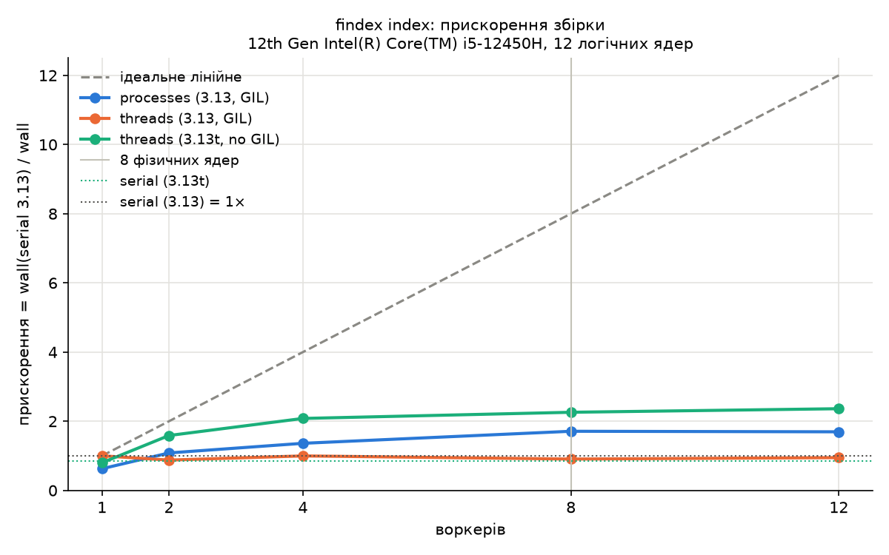

# findex

[](https://github.com/danilk202/findex/actions/workflows/ci.yml)

Навчальний пошуковик по текстовому корпусу: інвертований індекс, TF-IDF/BM25, мова запитів, CLI.

```
uv tool install .        # або: uv tool install findex-0.4.0-py3-none-any.whl
findex index data/ -o index.bin
findex search index.bin '(whale OR ship) "white whale"'
findex stats index.bin
```

Лабораторна 1 з курсу Python: ліниві ітератори, генератори та власний корпус.

## Корпус

25 книг із Project Gutenberg (англійською), ~17 МБ. Файли лежать у `data/`
і не комітяться. Завантаження, наприклад:

    cd data
    curl -L -o frankenstein.txt https://www.gutenberg.org/cache/epub/84/pg84.txt

(так само для інших книг: `cache/epub/НОМЕР/pgНОМЕР.txt`).

## Запуск

    uv run python -m findex.stats data/            # ліниво
    uv run python -m findex.stats data/ --limit 5  # перші 5 документів
    uv run python -m findex.eager data/            # жадібно, для порівняння
    uv run pytest

## Політика токенізатора

- Unicode нормалізується до NFC, потім `casefold()`.
- Слово: літери, цифри та `_` (`\w`), тож кирилиця працює.
- Апостроф (`'`, `’`, `ʼ`) і дефіс усередині слова лишаються частиною токена
  (`don't`, `п'ять`, `well-known`); на краях відкидаються.
- Цифри окремо лишаються токенами (`2026`), поруч із літерами входять у слово (`mp3`).

## Вимірювання

Корпус: 25 документів, 3 087 300 токенів, 54 323 унікальних слів.

| Версія | Документів | Пікова памʼять | Час |
|---|---|---|---|
| eager (списки) | 25 | 191,8 МіБ | 7,47 с |
| lazy (генератори) | 25 | 53,5 МіБ | 8,61 с |

## Пояснення

Eager-версія тримає в памʼяті одразу всі тексти та списки всіх токенів
(кожен токен це окремий обʼєкт `str`), тому пікова памʼять 191,8 МіБ.
Lazy-версія обробляє документи по одному й зберігає лише поточний текст
і `Counter`, тож вийшло 53,5 МіБ, тобто приблизно в 3,6 раза менше. Памʼять
lazy не нульова, бо в ній є найбільша книга та словник. За часом версії
майже не відрізняються: генератори економлять памʼять, а не час.

---

# Лабораторна 2. Інвертований індекс: словники, хешування та пам'ять

Продовження `findex` на тому самому корпусі: 25 книг, 54 323 унікальні терміни, 220 544 постінги.

## Структура

| Модуль | Призначення |
|---|---|
| `models.py` | `Posting` і `DocMeta`: `@dataclass(frozen=True, slots=True)` |
| `index.py` | побудова індексу за один прохід по ледачому пайплайну з лаби 1 (`defaultdict` + `Counter`), CLI збирання |
| `boolean.py` | Boolean-пошук (`a b` = AND, `OR`, `NOT`): двовказівниковий merge і альтернатива через `set` |
| `storage.py` | збереження й завантаження: `pickle` і `json` |
| `search.py` | CLI пошуку, друкує час і пік пам'яті |
| `bench.py`, `bench_io.py`, `membench.py` | бенчмарки з таблиць нижче |

## Запуск

```
uv run python -m findex.index data/ --out index.bin [--positions] [--format pickle|json]
uv run python -m findex.search index.bin "king NOT queen" [--engine merge|set]
uv run python -m findex.bench index.bin
uv run python -m findex.bench_io data/
uv run python -m findex.membench data/ plain|slots|array
uv run pytest
```

## Індекс

Індекс це словник `термін -> список Posting(doc_id, tf, positions)`. Документи обробляються в порядку зростання `doc_id`, тому кожен список постінгів автоматично відсортований за `doc_id`, і окреме сортування не потрібне (це перевіряє тест). Наприкінці `defaultdict` перетворюється на звичайний `dict`, щоб пошук по відсутньому терміну не створював порожніх записів. Позиції токенів вмикаються прапорцем `--positions`.

## Ціна позицій

| | Без позицій | З позиціями | Зростання |
|---|---|---|---|
| Файл (pickle) | 3.9 MiB | 16.2 MiB | ×4.2 |
| Файл (json) | 3.2 MiB | 21.0 MiB | ×6.6 |
| Пік пам'яті при побудові* | 69.2 MiB | 155.4 MiB | ×2.2 |

\* Виміряно під `tracemalloc`.

Без позицій для слова в документі зберігається одна пара «кількість входжень», а з позиціями кожне входження записується окремо. Тому розмір залежить уже від загальної кількості токенів, а не від кількості унікальних слів у документі.

## Формати збереження

| Позиції | Формат | Розмір, MiB | Save, с | Load, с |
|---|---|---|---|---|
| ні | pickle | 3.9 | 0.58 | 0.98 |
| ні | json | 3.2 | 1.06 | 0.58 |
| так | pickle | 16.2 | 1.02 | 1.23 |
| так | json | 21.0 | 3.35 | 1.24 |

Час міряється без `tracemalloc`, береться найкращий із трьох запусків. Під `tracemalloc` ті самі операції виходили в кілька разів повільнішими (збереження pickle 2.15 с замість 0.58 с, json 4.72 с замість 1.06 с), тому час і пам'ять міряються окремими запусками. Файл під час `load` майже напевно береться з кешу операційної системи, а не з диска, тож абсолютні числа завантаження оптимістичні.

Без позицій json вийшов компактнішим за pickle, а з позиціями більшим. Ймовірне пояснення: для дрібних чисел текстовий запис економний, тоді як pickle зберігає службові дані для кожного з 220 тисяч об'єктів `Posting`; великі числа позицій у json займають багато символів, а pickle кодує їх двійково. Це гіпотеза, окремим експериментом вона не перевірялась. Швидше завантаження json без позицій (0.58 с проти 0.98 с) я теж окремо не досліджував.

### Безпека pickle

`pickle.load` не просто читає дані: файл може містити інструкцію викликати довільну функцію (через `__reduce__`), яка виконається під час завантаження. Тому файл pickle, отриманий від іншої людини, може запустити шкідливий код на вашому комп'ютері. Завантажувати можна лише власні довірені файли; для обміну даними безпечніший json. Цей коментар є і в коді (`storage.load_pickle`).

## merge проти set

Списки постінгів тут короткі (до 25 елементів), оскільки в корпусі лише 25 документів. «Частий» термін зустрічається у 25 документах, «рідкісний» в одному. Час на один виклик, мікросекунди:

| Пара | Операція | merge | set |
|---|---|---|---|
| частий + частий | AND | 4.02 | 2.29 |
| частий + частий | OR | 4.53 | 2.50 |
| частий + рідкісний | AND | 2.97 | 0.91 |
| частий + рідкісний | OR | 6.44 | 2.82 |
| рідкісний + рідкісний | AND | 0.57 | 0.84 |
| рідкісний + рідкісний | OR | 0.82 | 0.90 |

Обидва двигуни повертають відсортований список `doc_id`, тому set-версії включають і побудову множин, і `sorted()`. Між запусками значення в часток мікросекунди плавають майже вдвічі (у попередньому запуску рідкісний + рідкісний AND дав 0.30 проти 0.51), тож порядок результатів надійніший за точні числа.

На списках по 25 елементів set швидший за merge приблизно в 1.5-3 рази. Merge програє не через алгоритм, а через те, що його цикл виконується інтерпретатором Python, тоді як `set(a) & set(b)` виконується в C. Merge виграє тільки на парі списків із одного елемента, де домінують фіксовані витрати на побудову множин. Переваги merge в іншому: він не створює додаткових структур у пам'яті й одразу віддає впорядкований результат. Корпус занадто малий, щоб робити висновки про великі індекси.

## Пам'ять: три варіанти зберігання постінгів

Той самий корпус, 220 544 постінги, `tracemalloc`, кожен варіант в окремому процесі.

| Варіант | Індекс, MiB | Байт на постінг | Пік, MiB |
|---|---|---|---|
| звичайний `@dataclass` | 30.4 | 145 | 75.3 |
| `@dataclass(slots=True)` | 22.0 | 105 | 68.3 |
| пари `array('I')` | 10.7 | 51 | 58.9 |

Порівнювати треба стовпець «Індекс»: пік містить тимчасові дані побудови (текст документа, `Counter`), яких у готовому індексі вже немає.

**Куди пішли байти.** Slots заощаджує близько 40 байт на постінг (28%): без нього кожен екземпляр несе додаткову інфраструктуру для довільних атрибутів, а зі slots зберігаються лише три поля фіксованого розміру (`getsizeof` одного постінга 56 байт). Різниця виміряна, а не розрахована з розмірів окремих об'єктів, бо `getsizeof(p.__dict__)` у Python 3.13 не відображає реальних витрат.

Варіант з `array('I')` економить найбільше (51 байт на постінг, удвічі менше за slots), бо постінг перестає бути об'єктом: пара `(doc_id, tf)` це два числа по 4 байти підряд без заголовка об'єкта та посилань. Самі дані займають лише близько 1.7 MiB із 10.7 MiB; решта (орієнтовно 9 MiB, це оцінка за різницею, а не окреме вимірювання) це витрати, спільні для всіх трьох варіантів: словник, рядки-терміни та по одному об'єкту-контейнеру на кожен із 54 323 термінів.

Ціна `array`: втрачаються іменовані поля, незмінність і позиції, а `Posting` при читанні доводиться створювати на льоту. Тому `slots` це розумний компроміс, коли потрібні об'єкти, а `array` вибирають, коли пам'ять важливіша за зручність.

---

# Лабораторна 3. Рейтинг і модель об'єктів

Продовження `findex` на тому самому корпусі (25 книг). Індекс став об'єктом «як у Python», Boolean-пошук перетворився на ранжований список зі сніпетами, а запити тепер підтримують дужки та фрази.

## Структура

| Модуль | Призначення |
|---|---|
| `index.py` | клас `Index(Mapping)`: `len`, `in`, `index[term]`, ітерація, `repr`; `num_docs`, `avg_doc_length` (`cached_property`), `df`; `open_index` — context manager |
| `scoring.py` | протокол `Scorer` і дві взаємозамінні реалізації: `TfIdf`, `BM25(k1=1.5, b=0.75)` |
| `ranking.py` | `search`: накопичує бали, топ-k через `heapq.nlargest`; `SearchResult(order=True)` |
| `query.py` | лексер і парсер рекурсивним спуском; вузли `Term`, `Phrase`, `And`, `Or`, `Not` з операторами `&`, `\|`, `~` і методом `evaluate(index)` |
| `timing.py` | декоратор `@timed` (з `functools.wraps`) |
| `engine.py` | `Searcher`: запит → дерево → кешовані id документів (`@lru_cache`) → рейтинг |
| `snippets.py` | вікно ±80 символів навколо найкращого входження, підсвічені терми |
| `search.py` | CLI |
| `sanity.py`, `evaluate.py` | три перевірки рейтингу і precision@5 з таблиць нижче |

## Запуск

```
uv run python -m findex.index data/ --out index.bin --positions      # позиції потрібні для фраз
uv run python -m findex.search index.bin 'python AND (async OR await) NOT java "event loop"'
uv run python -m findex.search index.bin "whale ship captain" "whale ship captain" -v   # лог @timed і кешу
uv run python -m findex.search index.bin                     # інтерактивний режим
uv run python -m findex.search index.bin "whale" --scorer tfidf
uv run python -m findex.search index.bin "king NOT queen" --engine merge   # Boolean з лаби 2
uv run python -m findex.sanity index.bin
uv run python -m findex.evaluate index.bin eval/queries.json --details
uv run pytest
```

## Index як об'єкт Python

`Index` наслідує `collections.abc.Mapping[str, list[Posting]]`. Реалізовано лише `__getitem__`, `__len__` і `__iter__`; `get`, `keys`, `items`, `==` дає сам `Mapping`. `__contains__` перевизначено тільки заради швидкості: стандартна версія ловить `KeyError`, а тут іде пряма перевірка у внутрішньому словнику.

`avg_doc_length` — це `cached_property`: середнє рахується один раз і кладеться в `__dict__` екземпляра. Через це в `Index` немає `slots`: без `__dict__` кешувати нікуди. До того ж `Index` один на програму, тож slots тут нічого б не заощадив, на відміну від 220 тисяч `Posting`.

`open_index(path)` написаний через `@contextmanager`: код до `yield` працює як `__enter__`, а `finally` — як `__exit__`. Тому індекс закривається навіть тоді, коли всередині `with` виник виняток (це перевіряє тест). Після закриття будь-яке звертання дає `ValueError`, як у закритого файлу.

Старий `boolean.evaluate` з лаби 2 приймав `dict`, але насправді використовував лише `.get()`, тому без жодних змін працює і з `Index` (duck typing).

## Мова запитів

```
or_expr  := and_expr ("OR" and_expr)*
and_expr := not_expr (["AND"] not_expr)*     # AND можна не писати
not_expr := "NOT" not_expr | atom
atom     := слово | "фраза" | "(" or_expr ")"
```

Кожне правило — окремий метод парсера. Пріоритет: `NOT` > `AND` > `OR`, тому `a OR b c` означає `a OR (b AND c)`. Дужки в `atom` знову викликають `or_expr`, звідси «рекурсивний» спуск. Результат — дерево:

```
python AND (async OR await) NOT java "event loop"
-> (((python AND (async OR await)) AND NOT java) AND "event loop")
```

Тести парсера порівнюють дерева, а не рядки: `parse("a OR b c") == a | (b & c)`. Це можливо, бо вузли є frozen-датакласами (`__eq__` порівнює поля), а `&`, `|`, `~` — це `__and__`, `__or__`, `__invert__` базового класу `Node`. `Phrase` перевіряє, що слова стоять на позиціях `p, p+1, …`, тому потребує індексу, зібраного з `--positions` (16.2 MiB замість 3.9 MiB, збірка 17.6 с).

Пошук іде у два етапи: дерево відбирає множину документів (Boolean), потім обраний скорер ранжує лише їх. Терми під `NOT` у бал не входять, а запит із самого `NOT` повертає документи з балом 0.

## Скорери

`Scorer` — це `typing.Protocol` з одним методом `score(tf, df, doc_len, stats)`. `TfIdf` і `BM25` від нього не наслідуються: будь-який об'єкт із таким методом є скорером. Так само `stats` — будь-що з полями `num_docs` і `avg_doc_length`; у тестах це `SimpleNamespace`, у програмі — `Index`.

- TF-IDF: `tf · ln(N / df)`
- BM25: `idf · tf·(k1+1) / (tf + k1·norm)`, де `idf = ln(1 + (N − df + 0.5)/(df + 0.5))`, `norm = 1 − b + b·len/avg_len`

## Три перевірки рейтингу на корпусі

Вивід `uv run python -m findex.sanity index.bin`.

**1. Рідкісний термін вище частого.** `whale` є у 5 книгах із 25, `captain` — у 20.

| Терм | df | idf TF-IDF | idf BM25 | BM25, tf=1, документ середньої довжини |
|---|---|---|---|---|
| whale | 5 | 1.609 | 1.553 | 1.553 |
| captain | 20 | 0.223 | 0.238 | 0.238 |

Одне входження `whale` важить у 6.5 раза більше за одне входження `captain`. Слово, яке є майже скрізь, мало що каже про те, який документ шукали; слово з усіх 25 книг отримало б idf ≈ 0 і взагалі не впливало б на порядок.

**2. 20-те повторення майже нічого не додає.** `whale` у Moby Dick (217 600 токенів):

| tf | BM25 | внесок саме tf-го входження | TF-IDF |
|---|---|---|---|
| 1 | 1.157 | +1.1567 | 1.6 |
| 2 | 1.782 | +0.6258 | 3.2 |
| 5 | 2.639 | +0.1957 | 8.0 |
| 10 | 3.143 | +0.0652 | 16.1 |
| 19 | 3.455 | +0.0211 | 30.6 |
| 20 | 3.474 | +0.0192 | 32.2 |
| 967 (реальний tf) | 3.874 | +0.0000 | 1556.3 |

20-те входження додає 1.7% від внеску першого. BM25 упирається в стелю `idf·(k1+1)`, а TF-IDF росте лінійно, тому за 967 китів дає 1556 і повністю домінує над рештою запиту.

**3. Коротка книга з одним входженням вище довгої.** Скрипт сам шукає найрідкісніший терм, що трапляється рівно один раз і в найкоротшій, і в найдовшій книзі: `causeless`, df = 2.

| Книга | Токенів | tf | BM25 | TF-IDF |
|---|---|---|---|---|
| jekyll_hyde | 28 867 | 1 | 3.574 | 2.526 |
| war_peace | 568 267 | 1 | 0.894 | 2.526 |

BM25 ставить коротку книгу в 4 рази вище, бо одне слово на 29 тисяч — помітніша частка тексту, ніж одне на 568 тисяч. TF-IDF довжини не враховує, і бали однакові.

## Precision@5: TF-IDF проти BM25

10 запитів у `eval/queries.json`; релевантні книги я позначив за змістом до запуску пошуку. P@5 — частка релевантних серед перших п'яти, ділення завжди на 5. Якщо релевантних лише дві книги, то навіть ідеальний пошук дає 0.40, тому поруч наведено максимум.

| Запит | Релевантних | TF-IDF P@5 | BM25 P@5 | Макс. P@5 |
|---|---|---|---|---|
| `whale OR ship OR sea` | 2 | 0.40 | 0.20 | 0.40 |
| `monster OR creature` | 3 | 0.40 | 0.40 | 0.60 |
| `murder OR crime` | 3 | 0.40 | 0.60 | 0.60 |
| `marriage love` | 4 | 0.60 | 0.40 | 0.80 |
| `treasure OR pirate` | 2 | 0.40 | 0.40 | 0.40 |
| `ghost OR spirit` | 2 | 0.20 | 0.20 | 0.40 |
| `war (soldier OR army)` | 2 | 0.40 | 0.40 | 0.40 |
| `"time traveller" OR future` | 1 | 0.20 | 0.20 | 0.20 |
| `river raft` | 2 | 0.40 | 0.40 | 0.40 |
| `rabbit OR witch` | 2 | 0.40 | 0.20 | 0.40 |
| **Середнє** | | **0.38** | **0.34** | 0.46 |

На моєму корпусі TF-IDF вийшов трохи кращим. Різниця — 2 влучання з 50 позицій, і на 10 запитах та 25 документах це не доказ переваги жодного методу. Цікавіше, де саме BM25 програє:

- `rabbit OR witch`: TF-IDF дає **oz**, **alice** на перших місцях, а BM25 — huck_finn, wuthering, tom_sawyer і лише четвертою **oz**. Ймовірне пояснення: через насичення в BM25 багато входжень одного слова (Кролик в Alice, відьма в Oz) майже нічого не додають після перших кількох, тож книга, де мимохідь трапляються **обидва** терми запиту, може обігнати книгу, глибоко присвячену одному з них. TF-IDF із лінійним tf, навпаки, нагороджує глибину. Для OR-запитів з альтернатив, де кожна релевантна книга відповідає лише одній з них, це грає проти BM25. Це гіпотеза, перевірити її можна, подивившись tf обох слів у цих книгах.
- `whale OR ship OR sea`: схожа картина. У Treasure Island немає жодного кита (tf = 0), тож вона має лише два терми з трьох і в BM25 поступається коротким книгам, де кит згадується хоч раз (The Prince, Call of the Wild).
- `murder OR crime`: тут BM25 кращий (0.60), бо коротка Jekyll and Hyde піднялась завдяки поправці на довжину, а довга War and Peace, де вбивство просто згадується, випала.

## @timed і кеш

Вивід `findex.search index.bin "whale ship captain" "whale ship captain" -v -k 5`:

```
  [findex.timing] Index.load took 997.37 ms
  [findex.index] opened index.bin: Index(docs=25, terms=54323, avg_len=123492.0, positions=True)
  [findex.cache] cache miss: ((whale AND ship) AND captain)
  [findex.timing] Searcher.search took 1.03 ms
  ...
  [findex.cache] cache hit:  ((whale AND ship) AND captain)
  [findex.timing] Searcher.search took 0.88 ms
```

`@timed` — декоратор-обгортка: міряє час через `perf_counter` і пише в `logging`. `functools.wraps` копіює `__name__`, `__qualname__` і `__doc__` оригіналу, інакше в лозі всі функції називалися б `wrapper`. Час пишеться у `finally`, тобто навіть тоді, коли функція впала. `@timed` стоїть на `Index.build`, `Index.load` і `Searcher.search`.

`@lru_cache` кешує шлях «дерево запиту → `frozenset` id документів». Просто задекорувати функцію `(index, query)` не можна: `Index` — це `Mapping`, а він не хешується. Тому кешована функція — замикання, яке «вшиває» індекс усередину, і ключем стає лише дерево (frozen-датаклас, хешується). Як наслідок, `a b` і `a AND b` використовують один запис кешу. Результат — `frozenset`, бо кешоване значення віддається всім викликачам і не повинно змінюватись.

Виграш від кешу тут маленький (1.03 → 0.88 мс), бо кешується лише Boolean-частина, а BM25 рахується заново при кожному запиті. Основний час іде на завантаження індексу (≈1 с).

## Сніпети

```
whale ship captain  [bm25]
  1.   5.178  moby  (217600 tokens)
       … the command of a whale ship was not wholly lodged in the person now called the captain, but was …
  2.   3.660  the_prince  (53171 tokens)
       … “an able statesman out of work, like a huge whale, will endeavour to overturn the ship unless he has an empty cask to play with.” …
  3.   3.068  call_wild  (35016 tokens)
       … Be a bad dog, and I’ll whale the stuffin’ outa you. Understand?” …
```

Для сніпета обирається входження, у вікні ±80 символів якого найбільше різних термів запиту. Межі вікна не розрізають слова, переноси рядків замінюються на пробіл. У терміналі терми підсвічуються кольором, при перенаправленні у файл — `**жирним**`.

Сніпети одразу показали обмеження «мішка слів». У The Prince кит — метафора, а в Call of the Wild «whale» взагалі дієслово («відлупцювати»). Формула не знає ні сенсу, ні частини мови, тому обидві книги для неї такі ж кандидати про китів, як і Moby Dick, просто з меншим балом.


---

# Лабораторна 4. Справжній інструмент: типи, тести, пакет, CLI

`findex` тепер ставиться однією командою і працює з будь-якого каталогу. Модулі `python -m findex.index` і `python -m findex.search` з лаб 2–3 замінено командою `findex`.

## Встановлення і запуск

```
uv tool install .                      # кладе findex у PATH
findex --help
findex index data/ -o index.bin        # смуга прогресу у stderr; --no-positions, --format json
findex search index.bin '(whale OR ship) "white whale"' -k 5
findex search index.bin whale --json > results.json   # чистий JSON у stdout
findex stats index.bin --top 10        # або --json
findex -v search ...                   # INFO: час @timed, кеш
findex -vv search ...                  # DEBUG: дерево запиту, кількість кандидатів
```

Без встановлення: `uv run findex ...` або `uv run python -m findex ...`.

**Windows PowerShell 5.1** «з'їдає» подвійні лапки всередині одинарних, тому фразу в запиті треба екранувати: `findex search index.bin '(whale OR ship) \"white whale\"'`. У PowerShell 7 і bash достатньо `'(whale OR ship) "white whale"'`.

**stdout і stderr.** У stdout іде лише результат (таблиця rich або `--json`), тому його можна перенаправити у файл чи `jq`. Логи, смуга прогресу і помилки йдуть у stderr. Logging налаштовується один раз, у `cli.main` (callback typer): 0 → WARNING, `-v` → INFO, `-vv` → DEBUG; модулі лише беруть `logging.getLogger(__name__)`.

**Помилки.** Очікувана помилка — це один рядок у stderr і ненульовий код виходу, без стека викликів:

| Ситуація | Повідомлення | Код |
|---|---|---|
| немає файлу індексу | `error: index file not found: x.bin (create it: findex index CORPUS)` | 1 |
| файл не є індексом | `error: x.txt is not a findex index (...)` | 1 |
| немає каталогу корпусу / порожній | `error: corpus directory not found: ...` / `no .txt files in ...` | 1 |
| `--out` веде в неіснуючий каталог | `error: output directory not found: ...` (перевіряється до збірки) | 1 |
| зламаний запит | `error: bad query: unexpected end of query` | 2 |
| фраза без позицій | `error: phrase search needs an index built with positions (...)` | 2 |
| невідома опція | стандартне повідомлення typer | 2 |

Усе це перехоплює один context manager `expected_errors()` у `cli.py`. Неочікуваний виняток (баг) навмисно не ховається: typer покаже стек.

## Пакет

`pyproject.toml` (PEP 621): метадані, версія 0.4.0, залежності `typer` і `rich`, група `dev` (pytest, pytest-cov, hypothesis, pyright, ruff). `uv.lock` закомічений, тому CI і будь-яка інша машина ставлять ті самі версії (`uv sync --locked`). `[project.scripts] findex = "findex.cli:app"` під час встановлення створює виконуваний файл `findex` (на Windows `findex.exe`), який імпортує `findex.cli` і викликає `app()`.

## Типи: pyright strict

`[tool.pyright] typeCheckingMode = "strict"` для `src/`: **0 помилок**. Що для цього знадобилось:

- `Scorer` і `CorpusStats` — `typing.Protocol`; pyright перевіряє, що `TfIdf`, `BM25` і `Index` їм відповідають, без жодного наслідування.
- Рядкові параметри — `Literal`: `Format = Literal["pickle", "json"]`, `Engine = Literal["merge", "set"]`, скорер `Literal["bm25", "tfidf"]`. Typer бере варіанти з тієї самої анотації, тож `--scorer nope` відхиляється ще до запуску.
- Генератори позначені `Iterator[...]`, вхідні послідовності — `Iterable[...]`; `open_index` — `Generator[Index]` (саме так вимагає `@contextmanager` у сучасному typeshed).
- JSON-вивід CLI описаний `TypedDict` (`ResultJSON`, `SearchJSON`, `StatsJSON`); сталі — `Final`.
- `type`-аліаси PEP 695: `type Postings = dict[str, list[Posting]]`.

Що pyright знайшов або змусив змінити:

- `cached_property` не вважається сумісним із `@property` у протоколі, тож `Index` «випав» із `CorpusStats`. Тепер `avg_doc_length` — звичайний `@property`, який читає приватний `cached_property _avg_doc_length` (кешування лишилось).
- `Phrase.evaluate` ітерувався по `p.positions`, які мають тип `tuple[int, ...] | None`. Додано явну обробку `None`, а фраза без позицій кидає окремий `NeedsPositionsError`.
- `bench_io.py`: lambda в циклі захоплювала змінні циклу пізно (ruff B023). Значення тепер фіксуються default-аргументами.
- `membench.py` повертав «або словник масивів, або словник списків» — розділено на дві функції з точними типами.

`# pyright: ignore` у коді рівно три, і кожен із коментарем «навіщо»: два в `storage.load_pickle` (pickle не зберігає типів; форму `(dict, list)` перевіряє `match`, а типи елементів вивести неможливо) і один в `engine.py` (тип, який повертає `lru_cache`, у typeshed має лише приватне ім'я `_lru_cache_wrapper`; імпорт стоїть під `TYPE_CHECKING`).

## Тести

`uv run pytest`: **173 тести**, з них `-m "not slow"` — 172 (менше секунди).

- `conftest.py`: фабрика корпусу `make_corpus`, маленький корпус і індекс (scope `function`, бо тести можуть закрити індекс), а також корпус і файл індексу для CLI (scope `session`: збираються один раз, тести лише читають).
- Токенізатор: `parametrize` на 21 випадок, з них Unicode — кирилиця, три види апострофа (`'`, `’`, `ʼ`), `Ґ/Ї`, `ß → ss` (casefold), грецька, японська, NFC (`e + ◌́ == é`), емодзі.
- Збірка індексу, merge і set, парсер (порівняння дерев), обидва скорери з трьома перевірками з лаби 3, save/load і пошкоджені файли.
- CLI через `typer.testing.CliRunner`: усі три команди, `--json` парситься `json.loads`, stdout і stderr перевіряються окремо (логи не потрапляють у stdout), кожна очікувана помилка — рівно один рядок і правильний код виходу, `-v`/`-vv`, `python -m findex`.

**Властивості Hypothesis** (`tests/test_properties.py`):

1. `Index.load(index.save(...)) == index` для випадкових корпусів, обох форматів, з позиціями і без (300 прикладів; на Windows сотні записів файлу займають кілька секунд → позначено `slow`, решта тестів коротші за 0.7 с).
2. Постінги завжди строго відсортовані за `doc_id`, `tf ≥ 1`, `len(positions) == tf`, позиції зростають.
3. `and_merge` / `or_merge` / `andnot_merge` збігаються з `&`, `|`, `-` над `set` (set тут — «оракул»).
4. `parse(str(tree)) == tree` для випадкових дерев запитів (`st.recursive`).
5. BM25 не спадає по tf і не перевищує стелі; TF-IDF лінійний по tf.

### Покриття

`uv run pytest --cov`: **97%** рядків і гілок (865 інструкцій, 16 непокритих).

Навмисно поза покриттям:

- `bench.py`, `bench_io.py`, `membench.py`, `eager.py`, `stats.py` — одноразові скрипти вимірювань з лаб 1–2, запускаються вручну, їхні результати — таблиці в README. Виключені в `[tool.coverage.run] omit`.
- `__main__.py` — дві строки; тест запускає `python -m findex` в окремому процесі, а coverage дочірні процеси не бачить.
- `__init__.py`: запасна гілка `PackageNotFoundError` (запуск з сирців без встановлення).
- `if __name__ == "__main__":` у скриптах.

## CI і реліз

`.github/workflows/ci.yml` на кожен push у `main` і на pull request, на Ubuntu і Windows: `uv sync --locked` → `ruff check` + `ruff format --check` → `pyright` → `pytest --cov`. Стан — бейдж на початку README.

`.github/workflows/release.yml` на тег `v*`: `uv build`, потім wheel ставиться в чистий venv і перевіряється `findex --version` / `findex --help`, і лише після цього створюється GitHub Release з wheel і sdist. Реліз v0.4.0 — сторінка Releases репозиторію.

## Reflection

**Хто і коли перевіряє анотації?** Інтерпретатор їх не перевіряє: анотації просто зберігаються в `__annotations__`. Перевіряє pyright — статично, до запуску (у редакторі й у CI). Виняток у цьому проєкті — typer: він читає анотації в рантаймі, щоб зробити з них опції (`Literal` → вибір, `bool` → прапорець, `int` з `count=True` → `-vvv`).

**Narrowing.** Звуження типу після перевірки: після `if m.lastgroup is not None` pyright знає, що там `str`; після `match data: case (dict(), list())` — що це кортеж зі словника і списку; після `if not postings: continue` — що список не `None`.

**Iterator чи Iterable?** `Iterable` — те, по чому можна пройти (`__iter__`), можливо кілька разів: список, словник. `Iterator` — одноразовий потік із `__next__`, і генератор якраз такий. Тому функції приймають `Iterable` (так їм підходить більше аргументів), а генератори повертають `Iterator`, чесно попереджаючи, що пройти можна лише раз.

**Protocol без наслідування.** Протокол описує форму: які методи й атрибути потрібні. Pyright перевіряє, чи об'єкт має цю форму (структурна типізація), а не чи він нащадок класу. `BM25` ніде не згадує `Scorer`, але має `score(tf, df, doc_len, stats) -> float`, тому підходить. У тестах `SimpleNamespace(num_docs=..., avg_doc_length=...)` теж підходить як `CorpusStats`.

**Scope фікстур.** `function` створює фікстуру заново для кожного тесту (ізоляція, безпечно для змінних об'єктів), `session` — один раз на весь прогін (для дорогого й незмінного). Індекс для CLI-тестів — `session`, бо тести його лише читають; індекс, який тест закриває, — `function`.

**Як писати властивості для merge.** Взяти простішу очевидно правильну реалізацію як оракула (`set`) і порівняти на довільних відсортованих списках без дублікатів: `and_merge(a, b) == sorted(set(a) & set(b))`. Hypothesis сам знайде граничні випадки (порожні списки, однакові, вкладені) і зменшить контрприклад до мінімального.

**Навіщо `src/`-layout.** Код лежить не в корені репозиторію, тож `import findex` у тестах бере встановлений пакет, а не випадково файли з поточного каталогу. Так тести перевіряють те, що реально потрапить у wheel (наприклад, забутий файл одразу зламає імпорт).

**Що створює `[project.scripts]`.** Під час встановлення pip/uv генерує маленький виконуваний файл `findex` у `bin/` (на Windows `Scripts\findex.exe`) оточення: він імпортує `findex.cli` і викликає `app()`. `uv tool install` кладе його в окреме оточення і додає в PATH.

**Чому `log.info("%s took %.2f ms", name, ms)`, а не f-рядок.** Із `%`-форматуванням рядок збирається лише тоді, коли повідомлення справді буде виведене. На рівні WARNING виклики `log.debug(...)` нічого не форматують. f-рядок форматувався б завжди, навіть якщо лог вимкнено. До того ж обробники отримують шаблон і аргументи окремо (зручно групувати однакові повідомлення).


---

# Лабораторна 5. Конкурентність і GIL: потоки, процеси і паралельна індексація

Лаба 4 збирала індекс на одному ядрі. **Результат:** на 8 ядрах процеси прискорили збірку в 1,7 раза (3,47 → 2,03 с), потоки під GIL — ніяк, а потоки на Python 3.13t без GIL — у 2,4 раза. Розбір «чому саме так» — на окремій сторінці: **[docs/lab5-why.md](docs/lab5-why.md)**.

Тепер `build_index` розділено на `build_partial` (індекс шматка корпусу, працює у воркері) і `merge` (злиття в батьківському процесі), а виконавця обирає прапорець.

```
findex index data/ -o index.bin                          # типово: --executor processes, --workers = усі ядра
                                                         # (processes типовий, бо на 3.13 з GIL вони виграли)
findex index data/ -o index.bin -x threads -w 4
findex index data/ -o index.bin -x serial                # звичайний цикл, без пулу
findex -v index data/                                    # INFO: стан GIL, час шматків, unpickle і merge
```

## Як влаштовано (`src/findex/parallel.py`)

```
corpus_files(data/) ── split(paths, N) ──► Chunk(start=0, paths=(…))  Chunk(start=9, …)  …
                                                 │                      │
                                  build_partial ─┤ (воркер)             ├─ (воркер)
                                                 ▼                      ▼
                                           Partial(0, …)          Partial(9, …)
                                                 └──────── merge ───────┘   (батьківський процес, 1 потік)
                                                              ▼
                                                    Index — той самий, що в лабі 4
```

- **У воркер ідуть шляхи, а не тексти.** `Chunk` — це `start` і кортеж рядків-шляхів: через pickle у процес іде кілобайт. Файли читає сам воркер, тож читання теж паралельне.
- **doc_id розподілені наперед.** `doc_id` — номер файлу у відсортованому списку, тому `split` ріже список на *суцільні* шматки, і шматок нумерує свої документи `start, start+1, …` ні з ким не домовляючись. Шматки вирівнюються за розміром у байтах, а не за кількістю файлів: книжки бувають у 10 разів різні, а збірка чекає на найповільніший шматок.
- **`build_partial` — функція рівня модуля** без спільного стану. Під `spawn` дочірній процес імпортує `findex.parallel` заново і шукає функцію за іменем, тому лямбда чи вкладена функція тут не спрацювали б. Внутрішньо це той самий `build_index` з лаби 4, лише для частини файлів і з іншим першим `doc_id`.
- **`merge`** сортує шматки за `start` і для кожного терміна дописує списки постінгів один за одним — вони лишаються відсортованими за `doc_id`. Діри або перекриття діапазонів → `ValueError`.
- **Виконавці.** `serial` — звичайний цикл, `threads` — `ThreadPoolExecutor`, `processes` — `ProcessPoolExecutor` з контекстом `spawn` явно (на Windows він і так типовий, а на Linux типовий `fork` приховав би помилки, які на Windows вилізуть). Код для всіх трьох однаковий: `map_partials(pool, chunks)`.
- **Падіння воркера.** Перший виняток скасовує ще не початі задачі й піднімається як `WorkerError`, а оригінал зі стеком воркера лежить у `__cause__` (для процесу `concurrent.futures` додає текст стека з дочірнього процесу). CLI друкує цей стек і `error: worker failed with …`, код виходу 1. Якщо процес помер «жорстко» (`os._exit`, segfault, OOM), пул кидає `BrokenProcessPool` → `error: worker process died abruptly`. Обидва випадки покриті тестами, жоден не зависає.
- **pickle без GC.** Результат процесу — це мільйон дрібних об'єктів. Воркер сам пакує `Partial` у `bytes`, а батько розпаковує його з вимкненим циклічним GC (`gc_paused()`). Чому — див. «Ціна pickle» нижче.

## Тести

`tests/test_parallel.py` (30 тестів) і 5 нових у `test_cli.py`:

- **`merge([build_partial(усі шляхи)]) == build_index(...)` з лаби 4** — окремий тест, з позиціями і без.
- `build_parallel` × {serial, threads, processes} × {1, 2, 4, 20} воркерів дає той самий індекс (20 > кількості файлів: шматків стає стільки, скільки файлів).
- Hypothesis: `merge` не залежить від порядку, у якому прийшли шматки (процеси завершуються як завгодно); `split` нічого не губить, не змінює порядок, не робить порожніх шматків і рахує `start` правильно.
- Падіння: відсутній файл у кожному виконавці → `WorkerError`, у `__cause__` — `FileNotFoundError`, для процесів — текст стека з `build_partial`; воркер з `os._exit(3)` → `died abruptly`, а не зависання.
- CLI: три виконавці дають однаковий JSON-індекс; `-w 0` і `-x gpu` → код 2; падіння у воркері → стек і один рядок `error:` у кінці stderr, файл індексу не створюється.

Заодно виправлено `corpus_files`: `rglob("*.txt")` знаходив і каталог з іменем `x.txt`, тепер лише файли.

## Машина

<!-- lab5:machine:start -->
- **Процесор:** 12th Gen Intel(R) Core(TM) i5-12450H
- **Ядра:** 8 фізичних / 12 логічних, RAM 15.8 ГіБ
- **ОС:** Windows 11
- **Python:** 3.13.5 (GIL) і 3.13.16 free-threaded, `sys._is_gil_enabled()` = `False`
<!-- lab5:machine:end -->

## Заміри на повному корпусі

Кожна клітинка — медіана з 3 запусків, кожен запуск — окремий свіжий процес (`python -m findex.parbench one ...`): пік RSS монотонний, і в спільному процесі другий замір успадкував би пік першого. Повтори перемежовані (усі конфігурації, потім ще раз усі), а перед замірами один прогрів, щоб файли були в кеші ОС. Індекс з позиціями (як типово в CLI).

- **wall** — час на годиннику від `split` до кінця `merge`, разом із запуском пулу;
- **CPU** — процесорний час батька (усіх його потоків) плюс воркерів-процесів (`psutil`, знято до `shutdown`, поки вони живі). **CPU / wall** — скільки ядер у середньому було зайнято;
- **пік RSS** — лише батьківського процесу (на Windows — peak working set);
- **unpickle** — розпаковка результатів у батька (лише процеси), **merge** — саме злиття;
- **прискорення** — `wall(serial, 3.13) / wall` — для всіх рядків одна база, тож 3.13t теж порівнюється з 3.13.

<!-- lab5:table:start -->
| Python | GIL | executor | workers | wall, с | CPU, с | CPU / wall | пік RSS, МіБ | unpickle, с | merge, с | прискорення |
|---|---|---|--:|--:|--:|--:|--:|--:|--:|--:|
| 3.13.5 | так | serial | 1 | 3.47 | 3.33 | 0.96 | 186 | 0.00 | 0.02 | **1.00×** |
| 3.13.5 | так | threads | 1 | 3.46 | 3.31 | 0.96 | 187 | 0.00 | 0.02 | **1.00×** |
| 3.13.5 | так | threads | 2 | 3.95 | 3.59 | 0.91 | 192 | 0.00 | 0.03 | **0.88×** |
| 3.13.5 | так | threads | 4 | 3.48 | 3.25 | 0.94 | 198 | 0.00 | 0.04 | **1.00×** |
| 3.13.5 | так | threads | 8 | 3.82 | 3.48 | 0.91 | 210 | 0.00 | 0.05 | **0.91×** |
| 3.13.5 | так | threads | 12 | 3.66 | 3.41 | 0.93 | 213 | 0.00 | 0.07 | **0.95×** |
| 3.13.5 | так | processes | 1 | 5.53 | 5.03 | 0.91 | 230 | 0.82 | 0.02 | **0.63×** |
| 3.13.5 | так | processes | 2 | 3.20 | 5.17 | 1.62 | 216 | 0.84 | 0.04 | **1.08×** |
| 3.13.5 | так | processes | 4 | 2.55 | 6.77 | 2.66 | 214 | 0.86 | 0.04 | **1.36×** |
| 3.13.5 | так | processes | 8 | 2.03 | 8.27 | 4.08 | 217 | 1.01 | 0.06 | **1.71×** |
| 3.13.5 | так | processes | 12 | 2.05 | 10.05 | 4.91 | 219 | 1.00 | 0.06 | **1.69×** |
| 3.13.16t | **ні** | serial | 1 | 4.10 | 3.80 | 0.93 | 244 | 0.00 | 0.03 | **0.85×** |
| 3.13.16t | **ні** | threads | 1 | 4.33 | 3.78 | 0.87 | 248 | 0.00 | 0.04 | **0.80×** |
| 3.13.16t | **ні** | threads | 2 | 2.18 | 3.58 | 1.64 | 263 | 0.00 | 0.04 | **1.59×** |
| 3.13.16t | **ні** | threads | 4 | 1.67 | 4.58 | 2.75 | 283 | 0.00 | 0.07 | **2.08×** |
| 3.13.16t | **ні** | threads | 8 | 1.53 | 5.66 | 3.69 | 326 | 0.00 | 0.08 | **2.26×** |
| 3.13.16t | **ні** | threads | 12 | 1.47 | 7.02 | 4.78 | 350 | 0.00 | 0.09 | **2.36×** |
<!-- lab5:table:end -->



Сирі дані всіх запусків: [`bench/lab5/results.json`](bench/lab5/results.json). Відтворити:

```
uv python install 3.13t
uv venv -p 3.13t .venv-ft
uv pip install -p .venv-ft -e . psutil
uv run --group bench python -m findex.parbench data/ --ft .venv-ft/Scripts/python.exe   # Linux/macOS: .venv-ft/bin/python
```

## Ціна pickle

<!-- lab5:pickle:start -->
Весь індекс корпусу як один `Partial`: **16.2 МіБ** у pickle.

| | з GC | GC вимкнено |
|---|--:|--:|
| `pickle.dumps` (у воркері) | 2.58 с | 2.27 с |
| `pickle.loads` (у батька) | 3.31 с | 1.50 с |
<!-- lab5:pickle:end -->

## Гонитва на спільному Counter

`python -m findex.race data/`: 8 потоків рахують 400 000 токенів у спільний `Counter`. Правильна відповідь відома наперед, тож кожне загублене оновлення видно.

<!-- lab5:race:start -->
```
Python 3.13.5, sys._is_gil_enabled() = True
8 потоків, 400,000 токенів; найгірший з 3 запусків
варіант                               отримано   загублено   час, с
спільний Counter, без Lock             400,000           0     0.15
спільний Counter + Lock                400,000           0     0.26
свій Counter у потоці + merge          400,000           0     0.10
спільний list.append (контроль)        400,000           0     0.05
```

```
Python 3.13.16, sys._is_gil_enabled() = False
8 потоків, 400,000 токенів; найгірший з 3 запусків
варіант                               отримано   загублено   час, с
спільний Counter, без Lock             384,370      15,630     1.24
спільний Counter + Lock                400,000           0     1.02
свій Counter у потоці + merge          400,000           0     0.31
спільний list.append (контроль)        400,000           0     0.11
```
<!-- lab5:race:end -->

## Протилежний дослід: ввід-вивід

`python -m findex.iobench`: 40 HTTP-запитів до локального сервера, який відповідає із затримкою 100 мс (імітація мережі; так результат відтворюваний і не навантажує чужі сайти; `--urls файл` — справжні URL).

<!-- lab5:io:start -->
Ввід-вивід: 40 запитів до локального сервера, затримка 100 мс; GIL увімкнено

| потоків | wall, с | CPU, с | прискорення |
|--:|--:|--:|--:|
| 1 | 4.62 | 0.08 | **1.0×** |
| 2 | 2.27 | 0.28 | **2.0×** |
| 4 | 1.12 | 0.23 | **4.1×** |
| 8 | 0.64 | 0.19 | **7.2×** |
| 16 | 0.34 | 0.17 | **13.5×** |
| 32 | 0.23 | 0.09 | **19.7×** |
<!-- lab5:io:end -->

## Висновки

Окрема сторінка: **[docs/lab5-why.md](docs/lab5-why.md)**. Там пояснено, чому потоки під GIL не прискорили індексацію, а процеси прискорили і чим за це заплачено (CPU time проти wall time, RSS, pickle), де в часі unpickle і merge видно закон Амдала, і що змінилося на 3.13t.

---

# Лабораторна 6. Асинхронний краулер: asyncio

Індексація з лаби 5 упирається в процесор. Краулер — навпаки: майже весь час він чекає на мережу. Тому тут один потік і один цикл подій тримають багато запитів одночасно, а індексація йде вже потім, окремою командою.

**Результат:** 300 сторінок за 30,9 с при одному запиті одночасно і за 4,8 с при двадцяти (у 6,4 раза швидше) при майже незмінних CPU і пам'яті. Без ліміту на хост — 13,1 с і 10 помилок. Розбір — у кінці розділу, «Чому так».

```
findex crawl http://127.0.0.1:8100/ -o pages.jsonl -n 300 -c 20 --per-host 4 --delay 0.02
findex index pages.jsonl -o web.bin          # iter_documents читає JSONL; поза циклом подій
findex search web.bin "white whale"
```

## Що і звідки обходимо

**Лише локальне дзеркало на власному комп'ютері**: `python -m findex.mirror data/` піднімає 4 HTTP-сервери (`127.0.0.1:8100`–`8103`, кожен порт — окремий «хост») і роздає наш корпус із лаби 1 (25 книг Project Gutenberg, public domain), порізаний на сторінки по ~1500 слів: 1966 сторінок. **Дозвіл:** це мій сервер, а його `robots.txt` дозволяє все, крім `/private/`. Чужі сайти в замірах не навантажуються.

Дзеркало навмисно «погане», щоб краулеру було що обробляти:

| адреса | що робить |
|---|---|
| `/flaky/1` | перший раз `503`, потім `200` |
| `/busy/1` | перший раз `429` з `Retry-After: 2` |
| `/slow/1` | перший раз відповідає 5 с — довше за таймаут |
| `/loop/a` ↔ `/loop/b` | зациклені редіректи `302` |
| `/moved/3` | `301` на сторінку, яка вже в черзі |
| `/gone` | `404` |
| `/private/notes` | заборонено `robots.txt` |
| будь-яка | затримка 50–100 мс («мережа»); понад 6 одночасних запитів на хост → `429` з `Retry-After: 1` |

Краулер працює і зі справжніми сайтами, якщо їхній `robots.txt` це дозволяє: `findex crawl https://docs.python.org/3/ -n 200` (типово `--per-host 2 --delay 0.25` — ввічливо). **User-Agent** чесний, з адресою для зв'язку: `findex/0.6.0 (+https://github.com/danilk202/findex; danilcreativniy@gmail.com)`. **Стеля** — `--max-pages` (типово 200).

## Як влаштовано

- **`urls.canonicalize`** — одна адреса, один рядок: схема і хост у нижньому регістрі, порт за замовчуванням прибирається, `#фрагмент` відкидається, порожній шлях → `/`, подвійні слеші і `.`/`..` згортаються, параметри query сортуються, `%xx` — у верхньому регістрі. Кінцевий слеш **не** прибирається: `/docs` і `/docs/` — різні адреси, і сервери редіректять між ними; якби ми їх склеїли, редірект вів би в «уже бачену» адресу, і сторінка загубилась би.
- **`fetch`** — одна адреса з повторами. Кожна спроба під `asyncio.timeout`; записуються статус, байти і час (`elapsed` — сама спроба, `total` — з чергою до хоста і паузами). Повтор — лише для `429`, `5xx` і таймауту, щонайбільше 3 повтори (4 спроби), пауза — exponential backoff з повним jitter: випадково з `[0, min(10, 0.5·2ⁿ)]` с. `Retry-After` (секунди або HTTP-дата) — нижня межа паузи, і на цей час «засинає» весь хост, а не лише один запит; якщо сервер просить більше 60 с — здаємось. Інші `4xx`, `3xx` і мережеві помилки не повторюються. Тіло обрізається на 5 МБ.
- **`RobotsCache`** — `robots.txt` окремо для кожного `scheme://host:port`, один раз: у кеші лежить `Task`, тож 20 воркерів, які одночасно прийшли на новий хост, чекають на одне завантаження. `4xx` → можна все, `5xx` або сервер недоступний → не можна нічого (RFC 9309). `Crawl-delay` збільшує паузу для хоста.
- **`Crawler.pages()` / `crawl()`** — асинхронний генератор. Усередині: черга адрес (`PriorityQueue`: спершу вся глибина 1, потім 2…, а всередині глибини хости чергуються), `concurrency` воркерів у `TaskGroup`, **один семафор на всі запити** і **окремий на хост** (`HostGate`: `--per-host` одночасних і `--delay` між стартами). Спершу місце в хості, потім у спільному семафорі: навпаки воркер, що чекає на зайнятий хост, тримав би спільне місце. Множина `seen` не дає завантажити адресу двічі; редіректи краулер обробляє сам (канонізація, `seen`, не більше 5 поспіль), тож петля `/loop/a ↔ /loop/b` зупиняється на другому кроці.
- **Кінець.** На `max_pages` (або коли черга спорожніла) одна з «вартових» задач кидає `_Stop`; `TaskGroup` скасовує всіх воркерів, `async with httpx.AsyncClient` закриває клієнт. Сам генератор лише бере готові сторінки з обмеженої черги, тому `break` у `async for` не потрапляє всередину `TaskGroup` — задача просто скасовується. Тест перевіряє, що після `break` нових запитів немає, а клієнт закритий.
- **Ніщо не блокує цикл.** HTML розбирає stdlib `html.parser` (`extract.py`: заголовок, видимий текст без `script`/`style`, посилання з урахуванням `<base>` і `nofollow`) — це чистий CPU, тому через `asyncio.to_thread`. Запис рядка JSONL — мікросекунди.
- **`findex crawl`** пише JSONL у міру надходження (рядок на сторінку, `flush` після кожного) і не тримає сторінки в пам'яті; `rich` показує, скільки зібрано, сторінки/с, скільки запитів чекає відповіді, помилки, повтори і глибину черги. `crawl.log` — рядок на кожен URL. `--debug` вмикає asyncio debug (`slow_callback_duration = 0.1`), і його попередження теж ідуть у `crawl.log`.
- **`iter_documents`** з лаби 1 тепер читає і `.jsonl` (по рядку, обірваний останній рядок пропускається). Шлях документа — локатор `pages.jsonl#17` (номер рядка), за ним `findex search` дістає текст для сніпета. `findex index pages.jsonl` будує індекс звичайною синхронною програмою — цикл подій краулера на той момент уже завершився.

## Тести

`tests/test_urls.py`, `test_fetch.py`, `test_robots.py`, `test_crawler.py`, `test_crawl_cli.py` — уся мережа через `httpx.MockTransport`, жодного живого запиту:

- канонізація (16 прикладів + відносні посилання + Hypothesis: `canonicalize(canonicalize(u)) == canonicalize(u)`);
- `fetch`: `200` записує статус/байти/час; `400–410` не повторюються; `503, 502, 200` → 3 спроби; `500` завжди → рівно 4 спроби; `429` з `Retry-After: 7` → пауза ≥ 7 с і пауза всього хоста; `Retry-After` як HTTP-дата; `Retry-After: 3600` → без повтору; таймаут → повтор; мережева помилка і `301` → без повтору; межі backoff (Hypothesis). Паузи підміняються, тести не чекають;
- `RobotsCache`: правила окремо для хостів і портів; 30 одночасних перевірок → по одному завантаженню на хост; `404`/`403` → можна, `5xx`/недоступний → не можна; `Crawl-delay`; правила для конкретного агента;
- краулер: рівно `max_pages`; кожна адреса не більше одного разу; дублікати з `#`, переставленим query, `HTTP://`, `:80` — один запит; `robots.txt`; петля редіректів і ланцюжок із 20 редіректів; ліміт на хост і спільний ліміт (лічильники в обробнику); пауза між запитами до хоста; чужий хост; `max_depth`; `404` і PDF; повтор `503` через краулер; `break` скасовує воркерів і закриває клієнт; HTML розбирається не в потоці циклу подій; **asyncio debug на 20 сторінках по ~60 КБ — жодного попередження про блокування** (поріг 100 мс);
- CLI: JSONL, `crawl.log`, `--stats-json`, `--max-pages`, `--debug`, кривий seed, і повний ланцюжок `crawl → index → search` зі сніпетом із JSONL.

## Машина

<!-- lab6:machine:start -->
- **Процесор:** 12th Gen Intel(R) Core(TM) i5-12450H, 12 логічних ядер
- **ОС:** Windows 11, Python 3.13.5
<!-- lab6:machine:end -->

## Заміри: concurrency 1, 5, 20

Той самий seed `http://127.0.0.1:8100/`, той самий `--max-pages 300`, `--timeout 2`, ліміт `--per-host 4 --delay 0.02`; кожен прогін — свіжий процес краулера і свіжий сервер (`python -m findex.crawlbench data/`), медіана з 3. Останній рядок — та сама робота без ліміту на хост.

<!-- lab6:table:start -->
| конфігурація | сторінок | wall, с | сторінок/с | CPU, с | помилок | повторів | пік RSS, МіБ |
|---|--:|--:|--:|--:|--:|--:|--:|
| c=1 | 300 | 30.91 | **9.7** | 2.72 | 1 | 3 | 47 |
| c=5 | 300 | 7.93 | **37.8** | 1.84 | 1 | 3 | 47 |
| c=20 | 300 | 4.84 | **61.9** | 2.16 | 1 | 3 | 48 |
| c=20, без ліміту на хост | 300 | 13.06 | **23.0** | 3.12 | 10 | 85 | 50 |
<!-- lab6:table:end -->

<!-- lab6:debug:start -->
Прогін з `--debug` (c=20, 300 сторінок, 5.9 с): попереджень asyncio «Executing ... took» — **0**.
<!-- lab6:debug:end -->

## Оброблені збої: рядки crawl.log

<!-- lab6:log:start -->
```
19:08:11.665 ROBOTS   http://127.0.0.1:8100/robots.txt -> 200: rules loaded
19:08:12.251 ROBOTS   disallowed            http://127.0.0.1:8100/private/notes
19:08:12.314 RETRY    503          try 2/4 in 0.26s http://127.0.0.1:8100/flaky/1
19:08:12.317 RETRY    429 Retry-After try 2/4 in 2.00s http://127.0.0.1:8100/busy/1
19:08:12.417 302             0B    171ms try=1 d=1 http://127.0.0.1:8100/loop/a  -> http://127.0.0.1:8100/loop/b
19:08:14.198 RETRY    timeout      try 2/4 in 0.37s http://127.0.0.1:8100/slow/1
19:08:14.411 404             9B     92ms try=1 d=1 http://127.0.0.1:8100/gone  ERROR
19:08:14.450 301             0B    104ms try=1 d=1 http://127.0.0.1:8100/moved/3  -> http://127.0.0.1:8103/book/crime_punishment/ (already seen, not fetched again)
19:08:14.527 302             0B     75ms try=1 d=1 http://127.0.0.1:8100/loop/b  -> http://127.0.0.1:8100/loop/a (already seen, not fetched again)
19:08:14.720 200           245B     99ms try=2 d=1 http://127.0.0.1:8100/flaky/1  page 85 (total 2.61s with retries)
19:08:14.998 200           251B    128ms try=2 d=1 http://127.0.0.1:8100/busy/1  page 110 (total 2.84s with retries)
19:08:15.047 200           241B     96ms try=2 d=1 http://127.0.0.1:8100/slow/1  page 116 (total 2.85s with retries)
```
<!-- lab6:log:end -->

## Індексація всередині корутини

`python -m findex.looplag pages.jsonl`: «серцебиття» прокидається кожні 10 мс і записує, наскільки запізнилось, а тим часом будується індекс зібраних сторінок.

<!-- lab6:looplag:start -->
| де індексація | час, с | найбільша затримка циклу, мс |
|---|--:|--:|
| прямо в корутині | 0.75 | 760 |
| asyncio.to_thread | 0.71 | 112 |
| окремий процес (run_in_executor) | 1.08 | 31 |

Вивід asyncio debug:

```
Executing <Task ... coro=<main.<locals>.run()> ...> took 0.755 seconds
Executing <Task ... coro=<main.<locals>.run()> ...> took 0.102 seconds
```
<!-- lab6:looplag:end -->

## Чому так: розбір замірів

### Чому 20 запитів в одному потоці швидші за підхід лаби 5

Краулер майже весь час **чекає**. При `c=1` збирання 300 сторінок тривало 30,9 с, а процесор за цей час відпрацював лише 2,7 с: понад 90% часу процес нічого не робив і чекав відповіді (кожна сторінка — ~100 мс «мережі»). При `c=20` ті самі 300 сторінок зібрались за 4,8 с, **у 6,4 раза швидше**, а CPU майже не змінився (2,2 с): роботи для процесора стільки ж, просто очікування тепер перекриваються. Поки один запит чекає на сокет, цикл подій встигає відправити інші й розібрати ті, що вже прийшли.

Підхід лаби 5 розпаралелює саме **процесорну** роботу, а її тут лише 2–3 с з 31. Навіть ідеальні 8 процесів зекономили б щонайбільше ці 2–3 с. Щоб мати 20 одночасних запитів, знадобилося б 20 процесів: кожен зі `spawn` (лаба 5: сотні мілісекунд на старт), з власним інтерпретатором на десятки МіБ, і кожну сторінку довелося б передавати батькові через pickle. Тут один процес тримає 20 запитів і має пік RSS **48 МіБ**, стільки ж, скільки при одному запиті (47 МіБ). Запит, що чекає, коштує одну корутину і один сокет.

Потоки теж масштабуються на вводі-виводі (лаба 5, `iobench`: 32 потоки дали 19,7×), бо очікування на сокеті відпускає GIL. Але `seen`, черга і лічильники були б спільними між потоками, і їх довелося б захищати блокуваннями (згадайте гонитву на `Counter` з лаби 5). В asyncio усе це змінюється в одному потоці, і перемикання стається лише на `await`, тому між перевіркою «адреса вже в `seen`?» і додаванням туди ніхто не вклиниться.

Чому 6,4×, а не 20×: одночасно в польоті щонайбільше 4 запити на хост × 4 хости = 16. Крім того, ~2,5 с на початку обходу йдуть на навмисні збої: `429` на `/busy/1` змушує хост 0 чекати 2 с, а `/slow/1` спершу «з'їдає» 2 с таймауту. Ці секунди однакові для будь-якого `c` і з'їдають частину виграшу.

### Чого коштує ліміт на хост і навіщо він лишився

**Ціна.** Більше `--per-host` запитів до одного хоста одночасно не піде, хоч би яким був `-c`. Якщо черга адрес зосереджена на одному хості (зазвичай так і є, коли обходиш один сайт), `-c 20` з `--per-host 4` працює як `-c 4`. До того ж `--delay 0.02` обмежує хост 50 запитами за секунду. Без ліміту теоретично можна було б тримати всі 20 запитів на одному хості. Саме тому краулер чергує хости всередині однієї глибини: так вільні місця дістаються іншим хостам, а не стоять у черзі за одним.

**Чому лишився.** Останній рядок таблиці — та сама робота з `--per-host 20 --delay 0`. Вийшло **13,1 с замість 4,8 с**: у 2,7 раза повільніше, 85 повторів і 10 адрес, які так і не вдалося завантажити. Сервер дзеркала, як і справжні сайти, захищається: якщо до нього одночасно приходить більше 6 запитів, він відповідає `429 Too Many Requests` з `Retry-After: 1`. Кожна така відповідь ставить весь хост на паузу щонайменше на секунду, а деякі адреси здаються після 4 спроб. Тобто «жадібний» краулер не швидший, а повільніший, і до того ж навантажує чужий сервер. На справжньому сайті наступним кроком був би бан за IP. Тому ліміт лишився. Для справжніх сайтів він ще суворіший: за замовчуванням `--per-host 2 --delay 0.25`, а `Crawl-delay` з `robots.txt` збільшує паузу.

### Де зупинився б цикл подій, якби індексація йшла всередині корутини

`build_index` для 300 зібраних сторінок — це 0,75 с чистого CPU. Якщо викликати його прямо в корутині, цикл подій стоїть **760 мс**, і asyncio debug пише `Executing <Task ... run()> took 0.755 seconds`. Усі ці 760 мс:

- ніхто не читає відповіді, які вже прийшли: дані лежать у буфері сокета;
- спрацьовують запізнілі `asyncio.timeout`: запит, якому лишалося 0,1 с, отримає «таймаут» не з вини сервера, а через нас, і піде на зайвий повтор;
- зупиняються паузи між запитами до хоста і `Retry-After`;
- застигає екран `rich`.

Якби індекс оновлювався після кожної сторінки, таких зупинок було б 300, по кілька мілісекунд кожна, і всі вони додавалися б до часу кожного запиту, що саме чекав.

Варіанти з таблиці вище:

- **`asyncio.to_thread`** допомагає лише частково: затримка 112 мс. Потік той самий процес і той самий GIL. Потік індексації ще й читає JSONL і на кожному читанні відпускає та знову забирає GIL, тож циклу подій GIL дістається рідко.
- **Окремий процес** дає 31 мс: у нього свій GIL.

`findex` робить ще простіше: краулер лише пише JSONL, а `findex index pages.jsonl` — окрема синхронна команда, яка запускається, коли цикл подій уже завершився. Індексація тоді взагалі не заважає збиранню, і для неї можна використати процеси з лаби 5.

Debug-режим знайшов і справжнє блокування в коді краулера. Перший прогін із `--debug` на Windows показав `Executing <Task 'crawl' coro=<Crawler._run()> ...> took 0.374 seconds`. Конструктор `httpx.AsyncClient` синхронно готує SSL-контекст і читає сотні сертифікатів, і на Windows це ~0,37 с. Тепер клієнт створюється в `asyncio.to_thread`, і повторний прогін із `--debug` дав **0** попереджень (див. вище). Тести цього не ловили, бо з `MockTransport` httpx SSL не створює.

І третій випадок — з CI. Спершу тест вимагав «жодного попередження» на сторінці в 1,5 МБ з порогом 50 мс. На моїх машинах він проходив, а на Windows-раннері GitHub Actions (повільніший, ще й під coverage) впав: `Executing <Task 'worker-0' coro=<Crawler._worker()> ...> took 0.363 seconds`. Розбір сторінки там ішов у `to_thread`, але потік розбору тримав той самий GIL, і цикл подій чекав на нього, як у досліді з `to_thread` вище. Тому тест розділено на два. Перший перевіряє головне: `extract` ніколи не виконується в потоці циклу подій. Другий — debug-режим на сторінках реального розміру (~60 КБ) з типовим порогом asyncio 100 мс. Мегабайтні сторінки так і лишаються слабким місцем: для них розбір довелося б виносити в окремий процес.

### Один оброблений збій: 429 з Retry-After

Рядки з `crawl.log` (прогін з `--debug`, `c=20`):

```
19:08:12.314 RETRY    503          try 2/4 in 0.26s http://127.0.0.1:8100/flaky/1
19:08:12.317 RETRY    429 Retry-After try 2/4 in 2.00s http://127.0.0.1:8100/busy/1
19:08:14.720 200           245B     99ms try=2 d=1 http://127.0.0.1:8100/flaky/1  page 85 (total 2.61s with retries)
19:08:14.998 200           251B    128ms try=2 d=1 http://127.0.0.1:8100/busy/1  page 110 (total 2.84s with retries)
```

1. О 12.317 `/busy/1` відповів `429` з `Retry-After: 2`. Це «тимчасова» помилка, тож fetch планує повтор: друга спроба з чотирьох. Пауза — `max(backoff із jitter, Retry-After)`, тобто сервер визначає нижню межу, і вона вийшла рівно 2,00 с.
2. Ту саму паузу отримав **увесь хост 8100** (`HostGate.pause`). Видно це за сусіднім рядком. `/flaky/1` отримав `503` на 3 мс раніше і за власним backoff мав повторити вже за 0,26 с, але його друга спроба пішла лише після паузи хоста: повна тривалість 2,61 с. Сервер попросив почекати всіх, не лише один запит.
3. Слот хоста під час паузи не зайнятий: кожна спроба бере окремий `slot()`. Тому інші хости (8101–8103) весь цей час працювали, і за ці 2,4 с краулер зібрав сторінки з 85-ї по 110-ту.
4. О 14.998 друга спроба `/busy/1`: `200`, повна тривалість 2,84 с з урахуванням очікування.

Поруч у тому самому лозі видно й інші збої:

- петля редіректів `/loop/a → /loop/b → /loop/a` зупинилась на другому кроці, бо `/loop/a` вже був у `seen`;
- таймаут `/slow/1` повторено, і друга спроба вдалась;
- `404` на `/gone` не повторювався;
- `/private/notes` не запитувався через `robots.txt`.
