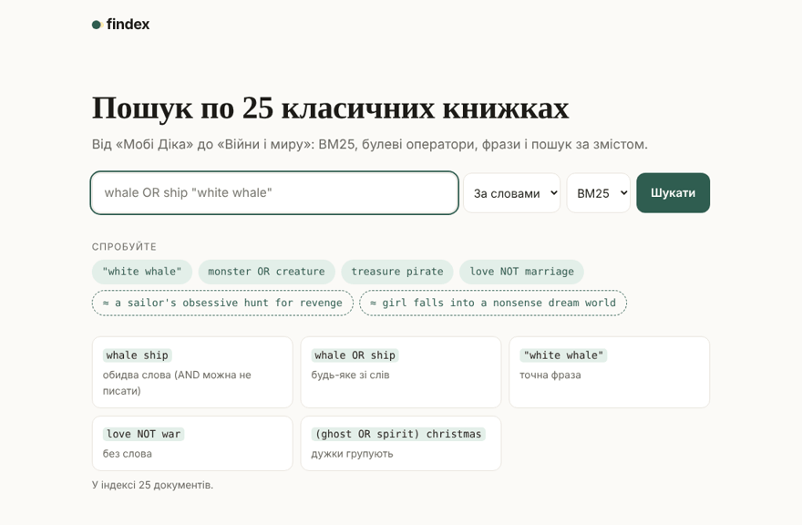
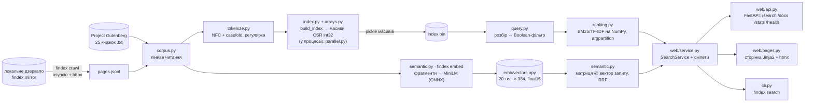
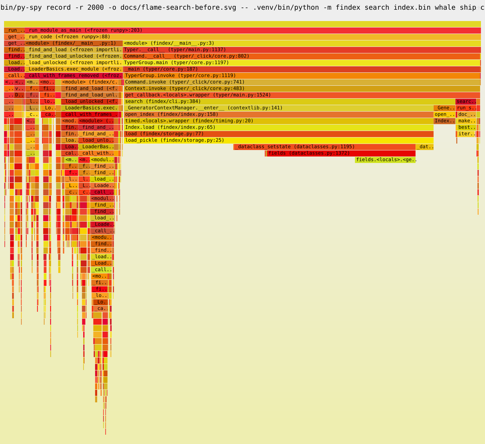

# findex

[](https://github.com/danilk202/findex/actions/workflows/ci.yml)
[](https://github.com/danilk202/findex/actions/workflows/docker.yml)

**findex — пошуковик по 25 класичних книжках, написаний з нуля на Python: інвертований індекс на NumPy, BM25, мова запитів і пошук за змістом через ембединги, з CLI, HTTP API і сторінкою.**

**Жива адреса: <https://findex-1cn9.onrender.com>** · API: [`/api/docs`](https://findex-1cn9.onrender.com/api/docs) · безкоштовний інстанс Render засинає після 15 хв без запитів, тож перший запит після паузи може йти до хвилини.



| корпус | p95 пошуку | найбільше прискорення |
|:---:|:---:|:---:|
| **25 книжок** · 3,09 млн слів · 17 МБ тексту | **34 мс** на прогрітому сервері (було 371 мс) | **90×** — завантаження індексу (1 328 → 15 мс) |

Відео на 2–3 хвилини: **[docs/demo.mp4](docs/demo.mp4)** — пошук за словами, фраза, пошук за змістом, гібрид, API.

```
uv tool install .                                   # або wheel зі сторінки Releases
findex index data/ -o index.bin                     # індекс з позиціями слів
findex search index.bin '(whale OR ship) "white whale"'
findex embed index.bin -o emb/                      # ембединги фрагментів (один раз, ~5 хв на CPU)
findex search index.bin "obsessive skipper's vendetta" --mode semantic
findex serve --index index.bin                      # http://127.0.0.1:8000
```

Зміст: [що вміє](#що-вміє) · [шлях даних](#шлях-даних) · [запуск](#запуск) · [структура](#структура) · [лаба 8](#лаба-8-швидше-потім-розумніше) · [усі виміри лаб 1–8](#усі-виміри-лаб-18) · [обмеження](#обмеження) · [детальні звіти лаб 1–7](docs/labs.md)

## Що вміє

- **Мова запитів:** `whale ship` (AND можна не писати), `whale OR ship`, `"white whale"` (фраза, потрібні позиції), `love NOT war`, дужки. Рекурсивний спуск у `query.py`.
- **Рейтинг:** BM25 або TF-IDF, бали рахуються виразами NumPy над усім списком постінгів терма; топ-k — `np.argpartition`.
- **Пошук за змістом** (`mode=semantic`): документ розбитий на фрагменти по 150 слів, кожен фрагмент — вектор all-MiniLM-L6-v2 довжини 1. Запит теж стає вектором, косинус до всіх фрагментів — одне множення матриці на вектор, документ отримує свій найкращий фрагмент.
- **Гібрид** (`mode=hybrid`): рейтинг BM25 і семантичний рейтинг зливаються через Reciprocal Rank Fusion.
- **Сніпети** з підсвіченими словами; для семантичного збігу — найкращий фрагмент.
- **Асинхронний краулер** (`findex crawl`): asyncio + httpx, robots.txt, повтори на 429/5xx, ліміт на хост, JSONL.
- **Паралельна індексація** процесами (`--executor processes`), а на Python 3.13t — потоками.
- **Веб:** FastAPI + Pydantic, сторінка на Jinja2 + htmx, Docker, деплой на Render.

## Шлях даних



Запит проходить так: `parse()` будує дерево (`And`, `Or`, `Not`, `Term`, `Phrase`), дерево обчислюється в множину `doc_id` (кешується `lru_cache`), BM25 рахує бали лише для цих документів, `argpartition` бере k найкращих, `SearchService` дописує назву з шапки Gutenberg і сніпет, а FastAPI перетворює dataclass на JSON або HTML. У режимі `semantic` замість дерева — вектор запиту, у `hybrid` — обидва рейтинги і RRF.

## Запуск

Потрібні Python 3.13 і [uv](https://docs.astral.sh/uv/).

```
git clone https://github.com/danilk202/findex && cd findex
uv sync                                             # залежності строго з uv.lock
uv run python -m findex.gutenberg data              # 25 книжок у data/ (у git їх немає)
uv run findex index data -o index.bin
uv run findex embed index.bin -o emb                # або взяти готовий emb/ з репозиторію
uv run findex serve --index index.bin               # http://127.0.0.1:8000, Swagger — /api/docs
uv run pytest                                       # 375 тестів, ~30 с
```

`findex embed` один раз качає модель (90 МБ, ревізія і sha256 зафіксовані в `semantic.py`) у `~/.cache/findex`. Готова матриця `emb/` лежить у репозиторії, бо рахувати її — хвилини CPU; сервер перевіряє, що вона зібрана для того самого корпусу (відбиток довжин документів у `emb/meta.json`), інакше вимикає семантичний режим з попередженням у лозі.

```
curl "http://127.0.0.1:8000/search?q=whale+OR+ship&k=5"
curl "http://127.0.0.1:8000/search?q=scientist+reanimates+a+cadaver&mode=semantic"
curl "http://127.0.0.1:8000/search?q=ghost+OR+spirit&mode=hybrid"
docker build -t findex . && docker run --rm -p 8000:8000 findex
```

## Структура

| модуль | що там | лаба |
|---|---|---|
| `corpus.py`, `tokenize.py` | ліниве читання `.txt`/JSONL, токенізатор | 1 |
| `models.py`, `storage.py` | `Posting`, `DocMeta`; pickle і json | 2, 8 |
| `index.py`, `arrays.py` | `Index` як `Mapping`, усередині — масиви NumPy (CSR) | 3, 8 |
| `query.py`, `engine.py` | мова запитів, `Searcher` з `lru_cache` | 3 |
| `scoring.py`, `ranking.py` | BM25, TF-IDF: формула для одного числа і для масиву; топ-k | 3, 8 |
| `snippets.py` | сніпети з підсвіткою | 3, 7, 8 |
| `cli.py` | typer + rich: `index`, `crawl`, `search`, `embed`, `stats`, `serve` | 4–8 |
| `parallel.py` | `build_partial` у пулі + `merge` | 5 |
| `crawler.py`, `fetch.py`, `robots.py`, `mirror.py` | асинхронний краулер і локальне дзеркало | 6 |
| `web/` | FastAPI, Pydantic, Jinja2, htmx | 7, 8 |
| `semantic.py` | фрагменти, MiniLM на onnxruntime, матриця `.npy`, RRF | 8 |
| `evaluate.py`, `sanity.py` | P@5, перевірки рейтингу | 3, 8 |
| `*bench.py`, `race.py`, `looplag.py` | скрипти замірів; результати — нижче | 1–8 |

---

# Лаба 8. Швидше, потім розумніше

Спершу виміряти, куди йде час, потім прискорити саме те місце, потім додати пошук за змістом.

<!-- lab8:machine:start -->
- **Процесор:** Intel(R) Xeon(R) Processor @ 2.10GHz, 2 логічних ядер, 7.8 ГіБ RAM
- **ОС:** Linux 6.18.44-fc-v378, Python 3.13.18
<!-- lab8:machine:end -->

Заміри лаб 1–7 — на моєму ПК (i5-12450H, Windows 11), лаби 8 — на машині вище, тож абсолютні числа між лабами напряму не порівнюються; «до/після» всередині лаби 8 міряні на одній машині.

## 1. Профіль до правок

```
uv run python -m cProfile -o bench/lab8/index-before.prof -m findex index data -o index.bin -x serial
uv run python -m cProfile -o bench/lab8/search-before.prof -m findex search index.bin "whale ship captain"
uvx py-spy record -r 250  -o docs/flame-index-before.svg  -- python -m findex index data -x serial
uvx py-spy record -r 2000 -o docs/flame-search-before.svg -- python -m findex search index.bin "whale ship captain"
uvx scalene run --cpu-only --profile-all -o scalene.json prog.py   # prog.py викликає те саме з Python
```

`-x serial`: cProfile бачить лише свій процес, а з процесами (`-x processes`, типово) вся робота йшла б у воркерах. Flame graph: [індексація](docs/flame-index-before.svg), [пошук](docs/flame-search-before.svg); після правок — [індексація](docs/flame-index-after.svg), [пошук](docs/flame-search-after.svg). Сирі профілі cProfile — `bench/lab8/*.prof` (`python -m pstats`).



Три найзатратніші місця, записані **до** будь-яких правок:

| # | де | частка часу | Python чи native (Scalene) | гіпотеза |
|---|---|---|---|---|
| 1 | `findex search`: `Index.load` → `pickle.load` | 59 % семплів py-spy; 1,12 з 1,56 с у cProfile | **Python**, хоча `pickle.load` — C: усередині 220 569 викликів `dataclasses._dataclass_setstate` і `fields()`; у Scalene рядки `dataclasses.py` — 13,7 % Python проти 4,8 % native | frozen + slots dataclass не має `__dict__`, тож pickle відновлює кожен `Posting` через Python-метод `__setstate__`. Якщо постінги — масиви, pickle скопіює буфери в C одним шматком |
| 2 | `findex index`: `tokenize` (генератор) + `pickle.dump` | 17 % + 19 % семплів | `yield m.group()`: 3,6 % Python, 7,1 % native — регулярка в C, але 3,09 млн `yield` і викликів `group()` з Python; у `dump` — знову Python-метод `__getstate__` на кожен `Posting` | токенізація впирається у виклики на кожен токен; запис — у ті самі dataclass-и, що й п. 1 |
| 3 | пошук на прогрітому сервері (`SearchService.search`, 150 запитів): `snippets.iter_hits` | **95–97 %** семплів, з них 97,5 % — рядок `probe.finditer(text)` | **native**: час у C-коді `re` | регулярка з `IGNORECASE` не може шукати літерал швидким пошуком підрядка і перевіряє кожну позицію тексту в 3 МБ. Сам BM25 — **0,1 %** семплів: на 25 книжках NumPy-скорер помітно не змінить час відповіді |

Дві побічні знахідки. Під cProfile `findex index` іде 7,5 с замість 4,2 с: детермінований профайлер обгортає кожен із 3 млн викликів `tokenize`, тож дрібні функції в ньому виглядають дорожчими, ніж є; py-spy семплює ззовні й програму не сповільнює. А `Condition.wait` на 23 % у flame graph індексації — це потік смуги прогресу rich, який просто спить.

## 2. Постінги як масиви NumPy

`arrays.py`, формат CSR, як у `scipy.sparse`: усі постінги всіх термів лежать підряд у двох масивах `int32` — `doc_ids` і `tfs`, а `indptr[r]:indptr[r+1]` — шматок терма номер `r`. Позиції — так само: `positions` (`int32`) і `pos_indptr`. Довжини документів — один масив `lengths` (`int32`). `Index` лишився `Mapping[str, list[Posting]]`, тож Boolean-пошук, тести лаб 2–4 і `sanity.py` працюють без змін: `index["whale"]` збирає список `Posting` з масивів на льоту. Старі файли індексу (pickle об'єктів і json) теж читаються.

BM25 над масивами (`scoring.py`) — той самий вираз, що й для одного числа, лише `tf` і `doc_len` тепер масиви всього списку постінгів терма:

```python
idf = self.idf(df, stats)                                   # одне число
norm = 1 - self.b + self.b * doc_len / stats.avg_doc_length  # масив: broadcasting скаляра
return idf * tf * (self.k1 + 1) / (tf + self.k1 * norm)     # масив, кожна операція — ufunc у C
```

`ranking.search_np` додає бали кожного терма в масив `scores` на всі документи (`scores[ids] += ...`), а `top_k` бере k найкращих через `np.argpartition` — O(n) замість повного сортування.

**Тест:** `tests/test_numpy_rank.py` порівнює з лабою 3 і порядок, і бали — **на рівність до біта**, не `approx`: операції ті самі й у тому самому порядку, тож і округлення float64 ті самі. Hypothesis ганяє 150 випадкових корпусів зі словника в 6 слів (багато однакових балів), з Boolean-фільтром і без, для BM25, TF-IDF і BM25 з іншими k1/b; окремий тест — 14 запитів лаби 3 на повному корпусі, якщо `data/` є.

**Баг, на якому стало зрозуміло, що таке argpartition.** Перша версія `top_k` була `ids[np.argpartition(-s, k-1)[:k]]` і потім `argsort` за балом. На всіх 14 запитах реального корпусу порядок збігся з лабою 3, а Hypothesis за секунду знайшов корпус `["a b", "a c", "a b", "c", "a"]` і запит `a`, k=2: лаба 3 дає `[4, 2]`, NumPy — `[4, 0]`. Документи 0, 1 і 2 мають однаковий бал, і `argpartition` гарантує лише, що k найбільших будуть спереду, а **хто з рівних на межі потрапить у k — довільно**. `heapq.nlargest` над `SearchResult(order=True)` при рівному балі бере більший `doc_id`. Тепер `top_k` бере всі бали, строго більші за k-тий, а з рівних k-тому — найбільші `doc_id`, і сортує `np.lexsort((-ids, -scores))`. На 25 книжках однакових балів майже не буває, тому реальний корпус цю помилку не ловив.

### Скорер лаби 3 проти NumPy

`python -m findex.profbench scorer data/`: лише рейтинг (Boolean-фільтр уже порахований і закешований, як на сервері), найкращий з 7 повторів, BM25, k=10. Скорер лаби 3 міряється на своїй рідній структурі — словнику списків `Posting` (`Lab3Index`). Другий корпус — ті самі книжки, порізані на шматки по 500 слів: так видно, що буде на довгих списках постінгів.

<!-- lab8:scorer:start -->
| корпус | запит | постінгів | кандидатів | лаба 3, мс | NumPy, мс | прискорення |
|---|---|---:|---:|---:|---:|---:|
| 25 книжок (25 док.) | частий: `the` | 25 | 25 | 0.043 | 0.033 | 1.3× |
| 25 книжок (25 док.) | рідкісний: `harpooneer` | 1 | 1 | 0.003 | 0.016 | 0.2× |
| 25 книжок (25 док.) | три терми: `whale ship captain` | 44 | 5 | 0.015 | 0.039 | 0.4× |
| шматки по 500 слів (6 156 док.) | частий: `the` | 6 154 | 6 154 | 6.560 | 0.250 | 26.3× |
| шматки по 500 слів (6 156 док.) | рідкісний: `harpooneer` | 36 | 36 | 0.058 | 0.035 | 1.7× |
| шматки по 500 слів (6 156 док.) | три терми: `whale ship captain` | 920 | 43 | 0.138 | 0.074 | 1.9× |
<!-- lab8:scorer:end -->

**Де виграш маленький і чому.** На 25 книжках список постінгів — не довший за 25: цикл Python проходить його за кілька мікросекунд, а кожен виклик NumPy коштує мікросекунду-дві сам по собі (перевірка типів, створення масиву-результату, диспетчеризація ufunc). Для `harpooneer` (один постінг) і запиту з трьох термів (44 постінги) NumPy **повільніший**: 10 операцій над масивами по 1–25 елементів дорожчі за 1–25 ітерацій циклу. Окупається NumPy там, де накладні витрати виклику діляться на тисячі елементів: `the` на шматках — 6 154 постінги, і там NumPy у **26** раза швидший. Цикл по об'єктах Python дорогий тим, що на кожен постінг — пошук атрибутів `p.tf`, `p.doc_id`, виклик методу `score`, створення об'єктів `float` і операції через `__add__`/`__mul__` з перевіркою типів; NumPy робить ту саму арифметику в C-циклі над суцільною пам'яттю `int32`/`float64` без жодного Python-об'єкта на елемент. Запит із трьох термів на шматках прискорився менше, бо в ньому лише 43 кандидати: лаба 3 рахує бали тільки для них, а NumPy — для всіх 920 постінгів, і потім відкидає зайве.

### Команди до і після

`python -m findex.profbench commands --before ../findex-lab7` (`git worktree add ../findex-lab7 lab-07`): обидва дерева на одній машині, медіана з 5 запусків, «пошук на сервері» — `SearchService.search` по 4 запитах × 20 разів.

<!-- lab8:commands:start -->
| що міряємо | лаба 7 | лаба 8 | разів |
|---|---:|---:|---:|
| `findex index data/` (процеси), с | 4.06 | 3.56 | 1.1× |
| `findex search index.bin 'whale ship captain'`, с | 1.07 | 0.31 | 3.5× |
| `Index.load`, мс | 1328 | 15 | 90.4× |
| пам'ять процесу з індексом, МіБ | 342 | 85 | 4.0× |
| файл індексу, МіБ | 16.2 | 16.1 | 1.0× |
| пошук на сервері (прогрітий), p50, мс | 188.4 | 17.9 | 10.5× |
| пошук на сервері (прогрітий), p95, мс | 371.4 | 34.0 | 10.9× |
<!-- lab8:commands:end -->

Звідки цифри:

- **`Index.load`** — гіпотеза 1 підтвердилась: замість 220 тисяч викликів Python `__setstate__` pickle читає сім масивів одним шматком кожен. Той самий файл за розміром (позиції `int32` займають стільки ж, скільки займали в pickle).
- **Пам'ять** — масиви `int32` замість об'єкта `Posting` (56 байт) з кортежем позицій (8 байт посилання + 28 байт на кожне число > 256) на кожен постінг.
- **`findex search`** тепер на 80 % складається з імпорту модулів (flame graph після). Звідти ж одна дрібна правка: `httpx` і краулер імпортуються лише в команді `crawl` — це була п'ята частина часу `findex search`.
- **`findex index`** прискорився менше: `pickle.dump` став дешевим (п. 2 гіпотез), а токенізація — та сама (див. обмеження).
- **Пошук на сервері** — це сніпети, нижче.

## 3. Сніпети: гаряче місце, якого не було в завданні

Профіль прогрітого сервера (п. 3 гіпотез) показав, що BM25 — 0,1 % часу, а 97 % — регулярка з `IGNORECASE` у `iter_hits`. Тепер текст документа один раз переводиться в нижній регістр (`lru_cache`, як і самі тексти), і на кожен терм — окремий шаблон, що **починається з літерала**: `re` знаходить його швидким пошуком підрядка, а не пробує кожну позицію. Межу токена після слова перевіряє lookahead у регулярці, межу перед словом — дві перевірки символів у Python, лише на справжніх збігах. Входження різних термів зливаються за позицією `heapq.merge`, ліниво, тож рання зупинка з лаби 7 працює. Якщо `lower()` змінює довжину тексту (`İ` → `i̇`), лишається старий шлях з `IGNORECASE`. Hypothesis порівнює результат з повною токенізацією, як у лабі 7.

`python -m findex.profbench snippets data/` — усі входження в усіх 25 книжках (без ранньої зупинки, тобто найгірший випадок):

<!-- lab8:snippets:start -->
| запит | входжень у 25 книжках | лаба 7, мс | лаба 8, мс | прискорення |
|---|---:|---:|---:|---:|
| `whale ship captain` | 2 281 | 545.6 | 56.0 | 9.7× |
| `whale OR ship OR captain` | 2 281 | 601.0 | 64.2 | 9.4× |
| `love marriage money` | 2 825 | 545.1 | 51.8 | 10.5× |
| `ghost OR spirit` | 647 | 429.4 | 40.3 | 10.7× |
<!-- lab8:snippets:end -->

## 4. Пошук за змістом

```
findex embed index.bin -o emb/              # фрагменти → ембединги → emb/vectors.npy
findex search index.bin "scientist reanimates a cadaver" --mode semantic
findex search index.bin "ghost OR spirit" --mode hybrid
curl "http://127.0.0.1:8000/search?q=scientist+reanimates+a+cadaver&mode=semantic"
```

На сторінці — перемикач «За словами / За змістом / Гібрид» і приклади запитів за змістом.

- **Фрагменти.** Текст ділиться на шматки по 150 слів без перекриття (`fragments()`): ~200 токенів WordPiece, менше за межу моделі 256. Корпус — **20 491 фрагментів**.
- **Модель** — all-MiniLM-L6-v2 (384 виміри), ONNX-експорт, ревізія і sha256 файлів зафіксовані. Запускається через `onnxruntime` і `tokenizers`, без torch: залежності — десятки мегабайтів замість гігабайтів. Ембединг фрагмента — середнє векторів його токенів (mean pooling, маска паддінгу множиться з broadcasting по осі 384), поділене на довжину.
- **Матриця** — `emb/vectors.npy`, 20 491 × 384, `float16` (15,0 МБ); `emb/fragments.npy` — `doc_id`, початок і кінець фрагмента в тексті. Збірка — 8 хв 22 с на моєму ПК (i5-12450H, 12 потоків; `findex embed`), на 2-ядерній машині вище — 25 хв.
- **`mode=semantic`**: вектори нормалізовані, тож косинус — це скалярний добуток, і для всіх фрагментів одразу це `vectors @ q` — одне множення матриці (20 491 × 384) на вектор. Документу зараховується найкращий фрагмент: фрагменти лежать за `doc_id`, і `np.maximum.reduceat` бере максимум кожного шматка. Цей фрагмент іде в сніпет. Кодування запиту — 6 мс, множення — 1,3 мс.
- **`mode=hybrid`**: перші 100 місць BM25 (з Boolean-фільтром) і перші 100 місць семантичного рейтингу зливаються через **Reciprocal Rank Fusion**: документ на місці r отримує 1 / (60 + r) від кожного списку. Бали BM25 (0–20) і косинуси (0–1) напряму не порівнюються, а місця — так.

### Precision@5: 10 запитів лаби 3 і 5 перефразованих

`python -m findex.evaluate index.bin eval/queries.json eval/paraphrases.json --emb emb`. Перефразовані запити (`eval/paraphrases.json`) я написав так, щоб **жодне змістовне слово запиту не траплялося в релевантній книжці** (перевірено по індексу: у «Мобі Діку» немає ні `obsessive`, ні `skipper's`, ні `vendetta`), і розмітив до першого запуску семантичного пошуку.

<!-- lab8:p5:start -->
| Запит | Набір | Релевантних | BM25 P@5 | Семантичний P@5 | Гібрид (RRF) P@5 | Макс. |
|---|---|---:|---:|---:|---:|---:|
| `whale OR ship OR sea` | queries | 2 | 0.20 | 0.40 | 0.40 | 0.40 |
| `monster OR creature` | queries | 3 | 0.40 | 0.40 | 0.40 | 0.60 |
| `murder OR crime` | queries | 3 | 0.60 | 0.20 | 0.40 | 0.60 |
| `marriage love` | queries | 4 | 0.40 | 0.40 | 0.40 | 0.80 |
| `treasure OR pirate` | queries | 2 | 0.40 | 0.40 | 0.40 | 0.40 |
| `ghost OR spirit` | queries | 2 | 0.20 | 0.20 | 0.20 | 0.40 |
| `war (soldier OR army)` | queries | 2 | 0.40 | 0.40 | 0.40 | 0.40 |
| `"time traveller" OR future` | queries | 1 | 0.20 | 0.20 | 0.20 | 0.20 |
| `river raft` | queries | 2 | 0.40 | 0.40 | 0.40 | 0.40 |
| `rabbit OR witch` | queries | 2 | 0.20 | 0.40 | 0.40 | 0.40 |
| `obsessive skipper's vendetta` | paraphrases | 1 | 0.00 | 0.20 | 0.20 | 0.20 |
| `bloodsucking undead aristocrat preys on englishwomen` | paraphrases | 1 | 0.00 | 0.20 | 0.20 | 0.20 |
| `youngster tumbles into a burrow, surreal dreamland` | paraphrases | 1 | 0.00 | 0.20 | 0.20 | 0.20 |
| `scientist reanimates a cadaver` | paraphrases | 1 | 0.00 | 0.20 | 0.20 | 0.20 |
| `skinflint tycoon redeemed at yuletide` | paraphrases | 1 | 0.00 | 0.00 | 0.00 | 0.20 |
| **Середнє: queries** | | | **0.34** | **0.34** | **0.36** | 0.46 |
| **Середнє: paraphrases** | | | **0.00** | **0.16** | **0.16** | 0.20 |
<!-- lab8:p5:end -->

**Що видно з таблиці.** На 10 запитах лаби 3 усі три режими майже рівні: 0,34 / 0,34 / 0,36. Ці запити складені зі слів, які в релевантних книжках справді є, і BM25 їх знаходить. Семантичний режим виграє там, де відповідь — тема, а не слово: на `rabbit OR witch` першою стає **alice** (у BM25 її немає в топ-5), на `whale OR ship OR sea` додається **treasure_island**, у якій немає жодного кита. Програє на `murder OR crime`: за змістом найближчими виявились фрагменти з Dorian Gray і Jane Eyre, а Sherlock і Jekyll and Hyde випали. На 5 перефразованих запитах BM25 дає **0**: слів запиту в цих книжках немає, і Boolean-фільтр нічого не пропускає. Семантичний режим знаходить потрібну книжку в топ-5 у **4 з 5** (Moby Dick і Alice — першими) і промахується на `skinflint tycoon redeemed at yuletide` — рідкісні слова, які маленька модель, схоже, знає погано. Гібрид на перефразованих збігається із семантичним, бо список BM25 порожній; на звичайних запитах він найкращий, але різниця з BM25 — одне влучання з 50, тож перевагою це назвати не можна. І ще одна закономірність, поки лише гіпотеза: у хвості семантичного топ-5 постійно з'являються довгі книжки (Moby Dick, Dracula, Great Expectations — 1 100–1 400 фрагментів проти ~200 у Christmas Carol). Документ отримує **максимум** серед своїх фрагментів, а серед тисячі фрагментів хоч один випадково близький знайдеться частіше, ніж серед двохсот. Перевірити можна, замінивши максимум на середнє трьох найкращих фрагментів.

## 5. pytest-benchmark у CI

`tests/test_bench.py`: `build_index`, перетворення в масиви, `Index.load`, пошук NumPy і скорером лаби 3, пошук входжень для сніпетів — на синтетичному корпусі (2000 документів за законом Ціпфа, без мережі). У звичайному `pytest` заміри вимкнені (`--benchmark-disable`), кожна функція виконується один раз як smoke-тест. Окрема задача `benchmarks` у CI вмикає їх, порівнює з попереднім прогоном на `main` (результати — у кеші GitHub Actions) і **падає, якщо мінімальний час будь-якого заміру виріс більш ніж на 35 %**; таблиця — у summary прогону.

## Reflection

**Чому цикл по об'єктах Python дорогий, а цикл NumPy — ні?** У Python кожен елемент — окремий об'єкт у купі: щоб додати два числа, інтерпретатор читає байткод, дістає типи обох операндів, шукає `__add__`, створює новий `float` і зменшує лічильники посилань старих. NumPy тримає числа суцільним блоком однакового типу і виконує одну C-функцію на весь масив, без жодного Python-об'єкта на елемент (часто з SIMD). Але виклик NumPy має свою фіксовану ціну, і на масиві з 1–25 елементів вона більша за сам цикл — це видно в таблиці.

**cProfile, py-spy, Scalene — що кожен показав?** cProfile — детермінований: точна кількість викликів (220 569 `__setstate__`), але сам сповільнює програму і найбільше — дрібні функції. py-spy — семплюючий, ззовні процесу: чесні частки часу і flame graph, без змін у програмі. Scalene розділяє час на Python і native — саме він показав, що в першому місці винен Python-код усередині C-функції `pickle.load`, а в третьому — C-код регулярки, тобто переписувати його на NumPy не було сенсу.

**Що таке broadcasting і ufunc?** ufunc — функція NumPy, що застосовується поелементно в C (`np.add`, `np.log`, `*`, `/`). Broadcasting — правило, за яким масиви різної форми розтягуються один під одного без копіювання: скаляр `b` множиться на весь масив `doc_len`, а маска форми (n, 256, 1) — на ембединги токенів (n, 256, 384).

**Навіщо argpartition, якщо є argsort?** argsort впорядковує все — O(n log n); argpartition лише ставить k найбільших перед рештою — O(n), і впорядковувати потім треба тільки k. Ціна — довільний порядок серед рівних, див. баг вище.

**Чому вектори нормалізуються?** Косинус = (a·b)/(|a||b|). Якщо довжини 1, косинус — просто скалярний добуток, і для всієї матриці це одне `vectors @ q`.

**Чому RRF зливає місця, а не бали?** Бали двох моделей мають різні шкали й розподіли: BM25 необмежений і залежить від запиту, косинус — від −1 до 1. Місця порівнянні завжди, а константа 60 не дає першому місцю одного списку переважити все інше.

**Чому `int32`, а не `int64`?** `doc_id`, tf і позиція в документі вміщуються в 2³¹, а масиви вдвічі менші — менше пам'яті, менше трафіку до кешу процесора. Зсуви (`indptr`) — `int64`, бо сумарна кількість позицій може перерости 2³¹ на великому корпусі.

---

# Усі виміри лаб 1–8

Кожна таблиця — з детальним поясненням у [docs/labs.md](docs/labs.md) (лаби 1–7) або вище (лаба 8). Лаби 1–7 міряні на i5-12450H / Windows 11.

### Лаба 1. Eager проти lazy

| Версія | Документів | Пікова памʼять | Час |
|---|---|---|---|
| eager (списки) | 25 | 191,8 МіБ | 7,47 с |
| lazy (генератори) | 25 | 53,5 МіБ | 8,61 с |

### Лаба 2. Інвертований індекс

Ціна позицій:

| | Без позицій | З позиціями | Зростання |
|---|---|---|---|
| Файл (pickle) | 3.9 MiB | 16.2 MiB | ×4.2 |
| Файл (json) | 3.2 MiB | 21.0 MiB | ×6.6 |
| Пік пам'яті при побудові* | 69.2 MiB | 155.4 MiB | ×2.2 |

Формати збереження (тоді — об'єкти `Posting`; у лабі 8 — масиви, див. вище):

| Позиції | Формат | Розмір, MiB | Save, с | Load, с |
|---|---|---|---|---|
| ні | pickle | 3.9 | 0.58 | 0.98 |
| ні | json | 3.2 | 1.06 | 0.58 |
| так | pickle | 16.2 | 1.02 | 1.23 |
| так | json | 21.0 | 3.35 | 1.24 |

`merge` проти `set`, мікросекунди на виклик:

| Пара | Операція | merge | set |
|---|---|---|---|
| частий + частий | AND | 4.02 | 2.29 |
| частий + частий | OR | 4.53 | 2.50 |
| частий + рідкісний | AND | 2.97 | 0.91 |
| частий + рідкісний | OR | 6.44 | 2.82 |
| рідкісний + рідкісний | AND | 0.57 | 0.84 |
| рідкісний + рідкісний | OR | 0.82 | 0.90 |

Пам'ять: три варіанти зберігання постінгів (лаба 8 пішла далі — масиви `int32` без жодного об'єкта на постінг):

| Варіант | Індекс, MiB | Байт на постінг | Пік, MiB |
|---|---|---|---|
| звичайний `@dataclass` | 30.4 | 145 | 75.3 |
| `@dataclass(slots=True)` | 22.0 | 105 | 68.3 |
| пари `array('I')` | 10.7 | 51 | 58.9 |

### Лаба 3. Precision@5: TF-IDF проти BM25

| Запит | Релевантних | TF-IDF P@5 | BM25 P@5 | Макс. P@5 |
|---|---|---|---|---|
| `whale OR ship OR sea` | 2 | 0.40 | 0.20 | 0.40 |
| `monster OR creature` | 3 | 0.40 | 0.40 | 0.60 |
| `murder OR crime` | 3 | 0.40 | 0.60 | 0.60 |
| `marriage love` | 4 | 0.60 | 0.40 | 0.80 |
| `treasure OR pirate` | 2 | 0.40 | 0.40 | 0.40 |
| `ghost OR spirit` | 2 | 0.20 | 0.20 | 0.40 |
| `war (soldier OR army)` | 2 | 0.40 | 0.40 | 0.40 |
| `"time traveller" OR future` | 1 | 0.20 | 0.20 | 0.20 |
| `river raft` | 2 | 0.40 | 0.40 | 0.40 |
| `rabbit OR witch` | 2 | 0.40 | 0.20 | 0.40 |
| **Середнє** | | **0.38** | **0.34** | 0.46 |

### Лаба 5. Паралельна індексація: потоки, процеси, 3.13t

| Python | GIL | executor | workers | wall, с | CPU, с | CPU / wall | пік RSS, МіБ | unpickle, с | merge, с | прискорення |
|---|---|---|--:|--:|--:|--:|--:|--:|--:|--:|
| 3.13.5 | так | serial | 1 | 3.47 | 3.33 | 0.96 | 186 | 0.00 | 0.02 | **1.00×** |
| 3.13.5 | так | threads | 1 | 3.46 | 3.31 | 0.96 | 187 | 0.00 | 0.02 | **1.00×** |
| 3.13.5 | так | threads | 2 | 3.95 | 3.59 | 0.91 | 192 | 0.00 | 0.03 | **0.88×** |
| 3.13.5 | так | threads | 4 | 3.48 | 3.25 | 0.94 | 198 | 0.00 | 0.04 | **1.00×** |
| 3.13.5 | так | threads | 8 | 3.82 | 3.48 | 0.91 | 210 | 0.00 | 0.05 | **0.91×** |
| 3.13.5 | так | threads | 12 | 3.66 | 3.41 | 0.93 | 213 | 0.00 | 0.07 | **0.95×** |
| 3.13.5 | так | processes | 1 | 5.53 | 5.03 | 0.91 | 230 | 0.82 | 0.02 | **0.63×** |
| 3.13.5 | так | processes | 2 | 3.20 | 5.17 | 1.62 | 216 | 0.84 | 0.04 | **1.08×** |
| 3.13.5 | так | processes | 4 | 2.55 | 6.77 | 2.66 | 214 | 0.86 | 0.04 | **1.36×** |
| 3.13.5 | так | processes | 8 | 2.03 | 8.27 | 4.08 | 217 | 1.01 | 0.06 | **1.71×** |
| 3.13.5 | так | processes | 12 | 2.05 | 10.05 | 4.91 | 219 | 1.00 | 0.06 | **1.69×** |
| 3.13.16t | **ні** | serial | 1 | 4.10 | 3.80 | 0.93 | 244 | 0.00 | 0.03 | **0.85×** |
| 3.13.16t | **ні** | threads | 1 | 4.33 | 3.78 | 0.87 | 248 | 0.00 | 0.04 | **0.80×** |
| 3.13.16t | **ні** | threads | 2 | 2.18 | 3.58 | 1.64 | 263 | 0.00 | 0.04 | **1.59×** |
| 3.13.16t | **ні** | threads | 4 | 1.67 | 4.58 | 2.75 | 283 | 0.00 | 0.07 | **2.08×** |
| 3.13.16t | **ні** | threads | 8 | 1.53 | 5.66 | 3.69 | 326 | 0.00 | 0.08 | **2.26×** |
| 3.13.16t | **ні** | threads | 12 | 1.47 | 7.02 | 4.78 | 350 | 0.00 | 0.09 | **2.36×** |

Ціна pickle (тому в лабі 8 постінги стали масивами):

| | з GC | GC вимкнено |
|---|--:|--:|
| `pickle.dumps` (у воркері) | 2.58 с | 2.27 с |
| `pickle.loads` (у батька) | 3.31 с | 1.50 с |

Ввід-вивід: 40 запитів із затримкою 100 мс:

| потоків | wall, с | CPU, с | прискорення |
|--:|--:|--:|--:|
| 1 | 4.62 | 0.08 | **1.0×** |
| 2 | 2.27 | 0.28 | **2.0×** |
| 4 | 1.12 | 0.23 | **4.1×** |
| 8 | 0.64 | 0.19 | **7.2×** |
| 16 | 0.34 | 0.17 | **13.5×** |
| 32 | 0.23 | 0.09 | **19.7×** |

### Лаба 6. Асинхронний краулер

| конфігурація | сторінок | wall, с | сторінок/с | CPU, с | помилок | повторів | пік RSS, МіБ |
|---|--:|--:|--:|--:|--:|--:|--:|
| c=1 | 300 | 30.91 | **9.7** | 2.72 | 1 | 3 | 47 |
| c=5 | 300 | 7.93 | **37.8** | 1.84 | 1 | 3 | 47 |
| c=20 | 300 | 4.84 | **61.9** | 2.16 | 1 | 3 | 48 |
| c=20, без ліміту на хост | 300 | 13.06 | **23.0** | 3.12 | 10 | 85 | 50 |

Індексація всередині корутини:

| де індексація | час, с | найбільша затримка циклу, мс |
|---|--:|--:|
| прямо в корутині | 0.75 | 760 |
| asyncio.to_thread | 0.71 | 112 |
| окремий процес (run_in_executor) | 1.08 | 31 |

### Лаба 7. Веб-пошук

`def` проти `async def`, 20 одночасних запитів:

| маршрут | один запит, мс | 20 запитів разом, мс | p50 у пачці, мс | найдовший, мс | `/health` під час пачки, мс |
|---|---:|---:|---:|---:|---:|
| `async def` | 85 | 1737 | 1472 | 2926 | 1451.8 |
| `def` (пул потоків) | 99 | 1493 | 1473 | 1500 | 66.2 |

Навантаження `oha -z 20s -c 20` (до лаби 8):

| конфігурація | запитів/с | p50, мс | p95, мс | p99, мс |
|---|---:|---:|---:|---:|
| 1 воркер, `async def` | 7.7 | 2433 | 4448 | 7693 |
| 1 воркер, `def` | 6.2 | 3120 | 4764 | 6093 |
| 4 воркери, `def` | 56.4 | 341 | 706 | 843 |
| розгорнутий (Render free) | 1.5 | 13406 | 14576 | 14577 |

### Лаба 8

Профіль, скорер, команди до/після, сніпети, P@5 семантичного пошуку — у [розділі лаби 8](#лаба-8-швидше-потім-розумніше).

# Обмеження

- **Корпус качається з Gutenberg, а там тексти зрідка оновлюють:** за місяць змінились Crime and Punishment, Frankenstein, Little Women і Moby Dick (на кілька десятків байтів), і стара матриця перестала підходити — образ Docker тоді перераховує її сам (13 хв замість 3).
- **Корпус маленький:** 25 англійських книжок. Списки постінгів — до 25 елементів, тож NumPy-скорер на ньому не виграє; таблиця на шматках по 500 слів показує, що було б на більшому корпусі.
- **Токенізація** — та сама регулярка з лаби 1, без стемінгу і стоп-слів: `whale` і `whales` — різні терми. Вона ж тепер найдорожча частина `findex index` (п. 2 профілю): виклик Python на кожен із 3 млн токенів. Я її не переписував.
- **Семантичний пошук:** модель англійська і бачить не більше 256 токенів фрагмента; фрагменти без перекриття, тож думка на межі двох фрагментів розрізається. `NOT` і лапки в режимі `semantic` ігноруються — модель отримує лише слова. Матриця прив'язана до корпусу: якщо Gutenberg змінить текст книжки, образ Docker скачає інший текст, і сервер вимкне семантичний режим, доки `emb/` не перерахувати.
- **P@5** — 15 запитів, розмічених мною; на такій вибірці різниця в кілька влучань не доводить перевагу методу.
- **Індекс цілком у пам'яті** й без оновлення: новий документ — це перебудова.
- **pickle** виконує код із файлу — `index.bin` можна відкривати лише власний.
- **Render free:** частка одного ядра і 512 МБ; сервіс засинає, і під навантаженням 20 одночасних з'єднань черга росте до секунд (таблиця oha лаби 7). Один воркер — бо кожен процес тримає свою копію індексу і моделі.
- **Краулер** обходив лише локальне дзеркало (лаба 6), чужі сайти не навантажувались.
- **Заміри лаби 8** зроблені на іншій машині, ніж лаб 1–7 (див. вище), тому абсолютні числа між лабами не порівнюються.
